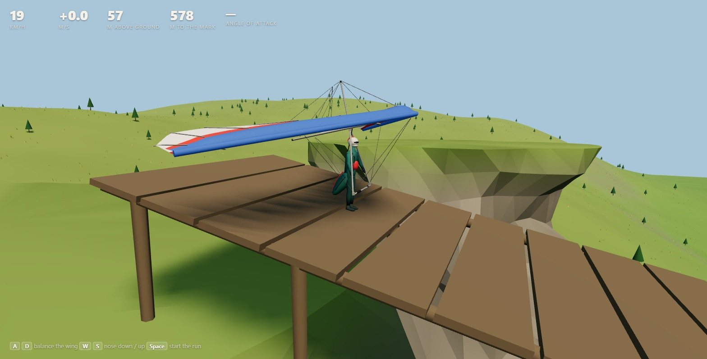
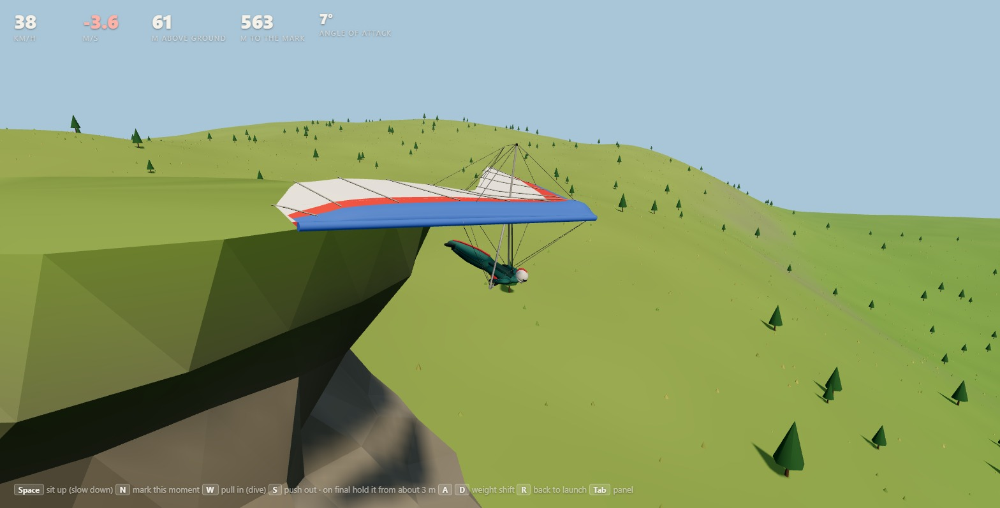

# hgsim

Hosts that animate their own glider can use `hgsim/three` to sample the posed feet, base bar and optional tires. Pass the measured clearance to `glider.step(dt, { contactClearance })` and use `sweepFlightContact` to find the first contact between fixed ticks. `canRollOnWheels` and `advanceWheelRoll` let a host drive a tire-supported rollout on its own terrain. Pass `part: 'wheel', rolledOut: true` when the glider stops to record a zero-point wheel rollout. The default headless contact path remains available through `glider.contact()`.

The hang-glider simulation from **Above**, and the landing range used to tune it.

<p>
  
  
</p>

Balancing the wing on the ramp before a Realistic launch, and a cliff launch just off the edge. Fly it at **https://hgsim.fly.dev**.

- **`src/`** is the SDK: plain ES modules with no dependencies. Its small core is a world, a glider and a pluggable flight model. Around the core are the launch run, landing judgement, the crash tumble, wind, a flight recorder and, in `hgsim/three`, the pilot's body and landing cues for Three.js.
- **`range/`** is the landing range: a small Three.js world with a ramp, a cliff and an open grass slope to launch from (C cycles them, R returns to the current one; on a touchscreen a thumb stick and buttons appear when it is touched), a field with a bullseye, and a thermal. It is for flying the SDK by hand, with live tuning and every round recorded.

The units are metres, seconds and radians throughout.

## Quick start

```bash
npm start          # the landing range at http://127.0.0.1:4180/range/
npm test           # unit tests (Node 22+)
npm run check:range  # flies the range end to end in a headless Chrome or Edge
```

No install step is needed. Three.js is vendored under `range/vendor/`, and nothing else is used.

## The SDK

hgsim is a small core with three parts: a **world**, a **glider** in it, and the **flight model** that steps the glider.

```js
import { createWorld, createGlider } from 'hgsim';

const world = createWorld({ terrain: (x, z) => 0, wind: { x: 0, z: -3 } });
const glider = createGlider({ world, at: { x: 0, y: 60, z: 0, heading: 0 } });

while (!glider.contact()) glider.step(1 / 60, { roll: 0, pitch: 0 });   // each frame, or in a loop offline
glider.land({ x: 0, z: 500, radius: 60 });   // { judged: 'firm', points, stars, notes: ['Firm touchdown', 'Into wind', ...] }
```

`examples/glide.mjs`, `examples/launch.mjs` and `examples/extend.mjs` run as they are:

```text
$ node examples/glide.mjs
stall 35 km/h; glided 553 m in 55.3 s, 48 km/h airspeed, sinking 0.69 m/s at the ground
landing hands off: firm Firm touchdown; Into wind; No flare

$ node examples/launch.mjs
0.00 s  pickup
1.50 s  balance
2.10 s  run
4.60 s  off the ground (flying) after 7.5 m at 10.0 m/s airspeed
5 s later: 52 km/h, 48 m out, 193 m over the ground
```

### The world

```js
const world = createWorld({
  terrain: (x, z) => height,          // the ground, m (default: flat at 0)
  surface: (x, z) => height,          // optional: tops of trees or buildings, for the glider's clearance
  wind: { x, z },                     // where the air goes, m/s: a vector, a live object (createWind()), or (x, y, z) => ({ x, z })
  thermals: [{ x, z, radius, strength }],
  lift: [(x, y, z, air) => metresPerSecond],   // your own rising or sinking air, added to the thermals and ridge lift
  air: { thermalCeiling: 1500 },      // AIR_DEFAULTS overrides
});
world.airAt(x, y, z);   // { lift, thermalLift, ridgeLift, extraLift, windX, windZ, groundHeight, aboveGround }
world.heightAt(x, z); world.surfaceAt(x, z); world.windAt(x, y, z);
```

Ridge lift comes from the terrain and the wind on its own, so a world needs nothing more than a height function.

### The glider

```js
const glider = createGlider({
  world,
  model: forceModel,                  // the default; classicModel or your own
  config: { mass: 100 },              // overrides of the model's defaults (GLIDER_DEFAULTS)
  at: { x, y, z, heading, airspeed }, // the starting flight state
  skim: false,                        // the terrain-skimming assist: true, or { clearance: m or bankedClearance }
  rules: {},                          // LANDING_RULES overrides for judging and scoring touchdowns
});
```

| Member | What it does |
|---|---|
| `step(dt, input)` | Flies `dt` seconds. `input`: `roll` −1 (left) … +1 (right), `pitch` (the bar) −1 (pulled in: dive) … +1 (pushed out: slow and flare), `stand` (sit up for drag), `field` (low over ground that can be landed on). |
| `state` | The live flight state: `x y z heading bank pitch airspeed pathAngle alpha bar verticalSpeed groundSpeed loadFactor lift stalled upright ...`. |
| `contact()` | `null` in the air. On the ground it returns the touchdown: `verticalSpeed` into the ground, `groundSpeed`, `slope`, `bank`, `wind`, `flare` and more. |
| `land(target)` | Judges and scores the touchdown, `contact()` by default, against a mark `{ x, z, radius }`. |
| `scrape(contact)` | A fast, light, level touch skips off the ground: `true` when it did, and the flight goes on. |
| `launch({ site, manual })` | Stands the pilot at the glider's position and returns a `Launch` (below). |
| `config`, `tune(patch)`, `overrides` | The frozen config, a change of some of its values in flight (`tune()` restores the defaults), and what differs from the defaults. |
| `performance` | The polar for the current config: `stallSpeed(bank)`, `trimSpeed(bar)`, `sink(v)`, `glideAngle(v)`, `glideRatio(v)`. |
| `reset(at)`, `place({ x, y, z, heading })` | A fresh flight state, or a move that leaves the flying as it is. |
| `air()`, `height()` | The air at the glider, and its height over the ground. |

Configs belong to the glider: two gliders with different numbers fly side by side, and nothing is global. `defineConfig(defaults, patch)` makes one on its own. It rejects unknown keys and values of the wrong kind with an error that names the key, so a typo cannot pass silently.

### The launch

```js
const launch = glider.launch({ site, manual: false });   // site: { fall(x, z, heading), edgeAhead(x, z, heading), ground?(x, z) }
while (!launch.airborne && !launch.failed) launch.step(1 / 60, controls);
// airborne: launch.reason is 'flying' or 'edge'. Carry on with glider.step(dt, { pitch: launch.barHold, ... }).
// failed: 'wingdrop', 'turned' or 'stumbled'. launch.tumble() is the wreck as a rigid body (stepTumble until done).
```

The run steps the glider's own flight state through the flight model's own lift and drag, so the run and the flight are one physics: nothing changes at lift-off. The wind and rising air come from the world, and the ground of the run comes from the site. An Easy launch (the default) runs itself. In a Realistic one (`manual: true`), `controls` carries `balance` (A/D), `nose` (W/S), `go` and `jump` (Space). `launch.pose(stride)` says where to draw the wing and the pilot.

### Glider presets and polars

Presets are named wings for the force model. Feel comes first. The force model's own defaults (the `intermediate` preset) are the wing the game was tuned on. Every other wing is that wing scaled to its own speeds, so the bar, the pitch and the flare respond the same way at the same share of each wing's speed range. Each wing's character then comes from a difficulty and five traits. The speeds are ballpark figures for each kind of wing, not fits to a published polar.

| Preset | Wing | Stall · trim · top (km/h) | Best glide | Character |
|---|---|---|---|---|
| `rogallo-1975` | 1970s standard Rogallo | 24 · 30 · 55 | 4.3 | Heavy, slow roll. Dived, the sail luffs and the nose keeps tucking: hands off it never recovers, and a full push-out takes seconds and height. |
| `cable-1979` | late-1970s high-aspect cable-braced wing | 26 · 34 · 72 | 7.1 | Heavy in roll, a stall that can bite, a milder luff. |
| `vintage-1985` | mid-1980s double-surface wing | 27 · 36 · 90 | 10.0 | Moderate. |
| `performance-1992` | early-1990s kingposted performance wing, VG off / on | 29 · 38 / 42 · 100 / 115 | 11.0 / 12.0 | Firmer than today's wings. |
| `alpha-235` | Wills Wing Alpha 235 trainer | 23 · 31 · 65 | 7.6 | The easiest to launch and land. Light, quick roll, a stall that only mushes. |
| `falcon-170` | Wills Wing Falcon 170 | 25 · 33 · 75 | 9.1 | Docile, a soft stall and a forgiving flare. |
| `sport-2` | Wills Wing Sport 2 155, VG off / on | 28 · 37 / 41 · 95 / 115 | 11.0 / 12.5 | Friendly loose, firmer tight. |
| `u2-160` | Wills Wing U2 160, VG off / on | 29 · 38 / 43 · 105 / 130 | 12.0 / 13.5 | Heavier roll when slow, a stall that can drop a tip. |
| `t2c-144` | Wills Wing T2C 144, VG off / on | 30 · 40 / 46 · 125 / 150 | 13.0 / 15.0 | The hardest to launch and land: heavy and quick to go over on the shoulders, a nose that rises on the run, a sharp stall that drops a tip, a flare that must be on time. |
| `intermediate` | the force model's defaults (a game wing) | 35 · 47 · 170 | 12.3 | The wing the range was tuned on. |

The ladder of modern wings runs from the easiest to launch and land to the hardest: Alpha, Falcon, Sport 2, U2, T2C. Every wing holds a dive with the bar in: the speed keeps building toward its top speed and the path stays steep.

Make your own wing with `defineWing`:

```js
import { defineWing, createGlider } from 'hgsim';

const wing = defineWing({
  id: 'mine', name: 'My wing',
  mass: 110, stall: 27, trim: 36, top: 100, glide: 11, aspectRatio: 6.5,   // kg, km/h, glide ratio
  difficulty: 0.5,                          // 0 a trainer .. 1 a topless competition wing (up to 1.2)
  character: { stall: 0.9 },                // any traits that differ: roll, stall, pitch, flare (0 forgiving .. 1 demanding)
  wing: { mass: 28, span: 10, dihedral: 0, carryAlpha: 12.5 },   // its build, for the launch: kg, m, degrees, degrees
  luff: { from: 2, loss: 0.6, tuck: 2.5 },  // an old sail that luffs when dived (optional)
  vg: { loose: { trim: 36, top: 95, glide: 11 }, tight: { trim: 40, top: 115, glide: 12.5, difficulty: 0.6 } },   // optional
  handling: { maxBank: 60 * Math.PI / 180 }, launch: { topSpeed: 7 },   // any force-model and launch values, over all of it
});
const glider = createGlider({ preset: wing });
```

- **`wingConfig({ mass, stall, trim, top, glide, aspectRatio })`** gives the force-model config for those speeds and that glide: the default wing's angles of attack, with the wing loading, trim and full-bar angles and parasite drag that hit them.
- **`handlingFor(character)`** gives the handling in the air for a difficulty or a set of traits, as `{ config }`: the force model's roll, stall, pitch and flare values.
- **The launch comes from the wing's build, not a trait.** The pilot carries the keel level, so the wing meets the air at its own `carryAlpha`: a billowy trainer high, near its stall, so it lifts off at a jog; a tight topless wing low, so it has to be run up to far more speed, or its nose lifted toward a sharp stall. The pilot's legs push with a fixed force, so a heavier pilot and wing gather speed more slowly. The wing's own mass is the weight on the shoulders, and its mass and span set its roll inertia there, scaling the pilot's hold on it, its weight tipping it over and the air rolling it. Its `dihedral` rights it in the air on the run, and anhedral (negative) helps it over. The feet leave the ground for good only once the wing can fly away: its glide over the ground, at that airspeed, in that wind and rising air, no steeper than the ground ahead falls. Until then the pilot runs on, the wing carrying them. A poor wing such as the Rogallo, or a shallow deck into a breeze, keeps them running to the edge.
- **The tip drop is physics, not a script.** A rolling wing's descending tip meets the air at a higher angle of attack. Past a stall whose lift falls away with angle (a small `stallBlend`, a low `plateLift`), that tip loses lift and the roll feeds itself (`rollDamping`), started by the air's small eddies (`airRoughness`). A wing whose stall only mushes never drops one.
- **The luff** is a nose-down moment that moves a luffed sail's trim angle down (`luffAlpha`, `luffLoss`, `luffTuck`).
- **The launch handling** lives on the preset (`preset.launch`) and reaches `glider.launch()` through `glider.launchConfig`.

`reference`, where a preset has one, is the real wing's published figures, drawn on the range's polar chart for comparison.

Where to flare depends on the wing and on how fast it arrives.

- **Measured flare zone:** `glider.flareZone()` flies the wing's finals at a range of approach speeds and records, for each speed, the heights from which holding the bar out lands softly.
- **In the range:** the landing cue's green zone and its FLARE prompt follow that measurement for the wing and its current airspeed.
- **No flare:** a touchdown that was never pushed out lands on the base bar. Above walking pace over the ground it is judged firm at best (`LANDING_RULES.unflaredGround`).

```js
const glider = createGlider({ world, preset: 't2c-144', config: { mass: 115 } });   // a preset, then your own changes on top
glider.polar();          // { points: [{ airspeed, sink, glideRatio }], stallSpeed, trimSpeed, topSpeed, minSink, bestGlide, speedToFly() }
glider.polar().speedToFly({ headwind: 5, sink: 1 });   // the airspeed for the flattest glide over the ground in that air
glider.usePreset('alpha-235');   // switch wings in flight; glider.tune() changes it further, glider.tune() alone restores it
glider.setVG(1);         // a wing with a VG (glider.hasVG): 0 loose (lighter roll, slower) .. 1 tight (flatter glide, heavier roll)
glider.pitchStability(); // { curves: [{ bar, points: [{ alpha, rate }], trim }], stiffness, lowAlphaRecovery }
glider.launchConfig;     // LAUNCH_DEFAULTS with the preset's launch handling
glider.reference;        // the real wing's published figures at the current VG, or null
glider.flareZone().at(airspeed);   // { low, high }: heights of the feet to flare from at this approach speed (null: none soft)
```

**The polar** is sink rate against airspeed in steady, straight flight. The highest point of the curve is the minimum sink, the speed to circle in lift. The point where a line from the origin just touches the curve is the best glide, the speed for distance in still air. Against a headwind or through sinking air, the speed to fly moves faster.

**Pitch stability** is how strongly a wing returns to its trimmed angle of attack after something pitches it away. hgsim's chart is the model's equivalent of a certification body's pitching-moment curve: the rate (°/s, positive is nose up) at which the wing pitches back toward trim at each angle of attack, at the steady speed for that angle, one curve each for the bar in, hands off and out. A curve that sags below zero at low angles is a wing with no will to pull out of a dive: the Rogallo's luffing sail.

`npm run polars` prints the presets side by side, VG off and on. In the range, the panel's Glider section picks a preset (also `?glider=t2c-144`) and sets the VG (key **V**). Its polar and pitch stability charts redraw as you tune or pull the VG.

### Vehicles

hgsim simulates air vehicles: the hang glider so far, with paragliders to follow. Games move through the world in vehicles, and the ones on the ground (the walker so far) are in `hgsim/ground`, on the same world, clock, poses and events ([docs/vehicles.md](docs/vehicles.md)). Every vehicle is stepped at a fixed tick and has the same small surface: `kind`, `phase`, `airborne`, `step(dt, input)`, `pose()`, `velocity()`, `on()` / `once()` and `state()`. They share three events: `airborne`, `touchdown` `{ impact }` and `crash` `{ kind, impact, hit }`. A game holds one vehicle and swaps it.

```js
import { createWorld, createHangGlider, terrainSite, createSimulationLoop, createPoseTrack, applyPose } from 'hgsim';
import { createWalker } from 'hgsim/ground';

const world = createWorld({ terrain, platform: rampDeck, material: (x, z) => (snowy(x, z) ? 'snow' : 'grass'), water: lakeLevel, solid: buildingAt, bounds });
let vehicle = createWalker({ world, at: { x, z, heading } });            // on foot to the launch
// ... then the pilot launches where they stand:
vehicle = createHangGlider({ world, preset: 't2c-144' });
vehicle.standAt(terrainSite(world, { x, z, heading })).launch();        // the run's slope and its edge, read from the world
vehicle.on('crash', e => damage(e.kind, e.impact, e.hit));               // 'terrain', 'solid' (hit names it), 'water', 'launch'

const track = createPoseTrack();
const loop = createSimulationLoop({
  step: dt => { track.push(vehicle.pose()); vehicle.step(dt, controls()); },
  render: (_, alpha) => applyPose(track.at(alpha, vehicle.pose()), mesh),
});
```

The world answers every vehicle's questions: `groundAt` (the terrain, or a deck or bridge above it, where feet stand and a glider lands), `slopeAt`, `normalAt`, `materialAt` (`MATERIALS`: grip and softness for grass, snow, ice, road, ...), `waterAt`, `solidAt` and `inBounds`. Each comes from a plain function the game passes to `createWorld`, and each has a default, so a world supplies only what its vehicles use. The walker's pace comes from the ground: uphill and soft ground are slower, ground too steep is a wall, ice slides, and water, solid things and the map's edge stop it. A ledge is a fall, and a hard landing is a crash.

### Rounds

A round is one go of a glider from the ground or the air to the end, the whole lifecycle in one place (`src/round.js`): standing at a launch, the launch run, the take-off with its bar hand-over, the flight, a scrape, the touchdown and its score, and a crash carried on as the tumble until the wreck is still. The range draws its rounds, and the scenarios fly theirs headless; both step the same code.

```js
import { createRound } from 'hgsim';

const round = createRound({ glider, target: { x: 0, z: 0, radius: 60 } });   // also realistic, ground, solid, landable, bodyPose
round.standAt(SITES.ramp).launch();     // any { start, fall, edgeAhead, ground }; or round.startAt({ x, y, z, heading, airspeed })
round.step(dt, { roll, pitch, nose, push, go, jump });   // each tick
round.phase;                            // 'ready', 'launch', 'flight', 'tumble', 'landed', 'crashed'
const off = round.on('touchdown', e => e.result.points);   // or round.on(e => e.type) for all of them; off() stops listening
round.once('airborne', e => e.dropped); // 'launch', 'airborne', 'failed', 'scrape', 'crash', 'touchdown' (ROUND_EVENTS)
round.state();                          // plain data, to record and draw again
```

A game steps a round at a fixed rate and draws between the ticks. `createSimulationLoop` does that, the "fix your timestep" pattern that cannon-es and Rapier use, so the same inputs fly the same flight at any frame rate:

```js
import { createSimulationLoop } from 'hgsim';

const loop = createSimulationLoop({ step: dt => round.step(dt, readControls()), render: (frameSeconds, alpha) => draw(alpha) });
requestAnimationFrame(function tick(now) { loop.frame(now); requestAnimationFrame(tick); });
```

### Scenarios and the lab

Scenarios are short, repeatable test flights for tuning how a wing feels (`src/scenarios.js`). Each sets up a site, a wind and a start, flies one thing and reports what happened as plain numbers, so the same scenario can be flown on every wing and compared.

- **Launch:** the ramp, the cliff and the slope in calm, breezy, gusty and cross winds; a sloppy pilot, nobody balancing, the nose held high and held low.
- **Flight:** a hands-off glide, a dive held and let go, a bar tap, roll reversals at trim and near the stall, a 360, a spiral, straight, turning and whip stalls.
- **Landing:** a final flared at the cue, too early, too late or not at all, a fast final, an eased-out flare, and calm, windy and gusty days.

A scripted pilot flies each the same way every time. The launch pilot balances, runs with the nose down and lets it up to fly off, and its skill can be turned down. The landing pilot flares from the wing's own measured cue. Everything else is the physics, and nothing is cut short: a launch that goes wrong, or a crash, plays out as the tumble.

```js
import { runScenario, startScenario, flyScenario } from 'hgsim';

runScenario('ramp-hands-off', { preset: 't2c-144' });   // { outcome: 'wingdrop', metrics: { maxRollDeg, ... }, samples }
runScenario('dive-hold', { preset: 't2c-144', vg: 1, config: { cd0: 0.02 } }).metrics.topKmh;
const run = startScenario('land-cue', { preset: 'falcon-170', pilot: 'you' });   // live: run.step(dt, { roll, pitch })
const flight = flyScenario('land-cue', { round, place });   // the same scenario on a round your game steps and draws
```

```bash
npm run scenarios                              # every scenario on the ladder (Alpha, Falcon, Sport 2, U2, T2C)
npm run scenarios -- landing --wings eras      # one kind, the eras from the Rogallo to today
npm run scenarios -- dive-hold --wings t2c-144,sport-2 --vg both
```

The lab flies the same scenarios in the range itself: in its world, its wind and its renderer, so what you tune is what you play. Press **L** in the range, or open `http://127.0.0.1:4180/range/?lab=launch` (or `flight`, `landing`).

- **The bar:** the lab is one slim bar along the bottom. The scenario list and the details (the traces, the result, the comparison, the notes) open above it when asked for (T), and H folds it all down to one small button.
- **Scenarios:** pick one from the bar; a scripted pilot flies it. Fly hands it to you. R runs it again. Any round you fly is recorded too.
- **Replay:** every tick is recorded as the renderer sees it, and replayed through the same renderer. P pauses, plays and replays at ¼× to 2×; the step buttons, or , and . (Shift for ten), move one frame at a time; drag the track in the bar, or the traces, to scrub.
- **Views:** the game's own camera, or the side, top, behind and in-front views, one at a time or all four (G, Q). Double-click a view to fill the screen with it; Esc goes back; the mouse wheel zooms. Grids every 10 m follow the glider in these views; the side view is a slice 40 m either side of the glider, so it shows the ground under its path.
- **Compare:** another wing flies the same scenario headless on the same ground: a blue dashed line in the world, blue traces on the timeline, and its numbers beside yours.
- **Notes:** N pins a note to the moment and the view you are looking at. Notes show as pins on the timeline and over the view at that moment, and the Notes tab lists them; click one to jump back. Each note is also saved to `work/notes/` for review, with the moment's numbers and, for a round you flew, the whole round with your inputs.
- **Feel:** the range's own side panel (Tab) tunes the wing live as before.
- **URL options:** `lab` (launch, flight, landing), `scenario`, `compare`, with the range's own (`glider`, `wind`, ...).

### Flight models

A model is a plain object: `{ name, defaults, createState(init, config), step(state, input, dt, world, config, skim) }`. Two more members are optional: `performance(config)` and `scrape(...)`. Two models come with hgsim:

- **`forceModel`**, the default: the wing as forces, with lift, drag, ground effect, stall, flare and push-out bar pressure.
- **`classicModel`**: the older, simpler energy model, kept for side-by-side comparison. In the range, use `?model=original`.

Any other object with the same shape drops in. `examples/extend.mjs` flies a point mass in ten lines.

### Modules

The package has three entry points: `hgsim` (`src/index.js`: the world, the clock, poses, events and the air vehicles), `hgsim/ground` (vehicles on the ground) and `hgsim/three`. Everything they export is the public API, typed in `types/` and covered by semantic versioning: a breaking change to it bumps the major version (the minor while the version is 0.x) and is listed in `CHANGELOG.md`. The modules below are its source. Within this repository they can be imported directly for the low-level functions the entry points leave out, such as `stepLaunch` and `liftCoefficient`, but those are internal and may change in any release.

| Module | What it does |
|---|---|
| `world.js` | The world: terrain, wind, thermals, ridge lift and extra lift sources. |
| `glider.js` | The glider handle and its launch. |
| `flight.js` | The force model: `GLIDER_DEFAULTS`, the aerodynamics, `stepFlight`, `performance`, `scrapeGround`. |
| `models/classic.js` | The classic model. |
| `launch.js` | The launch kernel: picking the wing up, balancing it, the run and the lift-off (`LAUNCH_DEFAULTS`). |
| `landing.js` | `LANDING_RULES`, `judgeTouchdown` and `scoreLanding`, and approach helpers: `measureFlareZone` (any wing's flare zone by approach speed), the default wing's `ZONE_LOW`/`ZONE_HIGH`, `pullOutHeights`, `dropToImpact`. |
| `tumble.js` | A launch or landing gone wrong as a rigid body. It has gravity, a flat-plate sail and ground contact with friction, and runs until the wreck comes to rest. |
| `wind.js` | Live wind: a mean speed and direction with a meander and gusts, and conversions to and from compass bearings. |
| `recorder.js` | Records each round as samples and marked moments. `tools/flight-report.mjs` reads them back. |
| `config.js` | `defineConfig` and `overridesOf`. |
| `loop.js` | `createSimulationLoop`: fixed ticks, drawn once per frame with the alpha to interpolate by. |
| `presets.js`, `polar.js` | The glider presets and `defineWing` (a wing from ballpark speeds and a character), and the polar and pitch stability of any glider (`polarOf`, `pitchStabilityOf`). |
| `round.js` | A round: the hang glider as a vehicle, the whole lifecycle of a go from standing at a launch to the end (`createRound`, `createHangGlider`). |
| `ground/` (`hgsim/ground`) | The vehicles on the ground: the walker, on foot on the world's ground (`createWalker`). |
| `sites.js` | Launch sites read from the world (`terrainSite`). |
| `pose.js`, `events.js` | Poses and their interpolation (`lerpPose`, `createPoseTrack`, `applyPose`), and the events every vehicle uses (`createEmitter`). |
| `scenarios.js` | Repeatable test flights for tuning the feel: `SCENARIOS`, `SITES`, `runScenario`, `startScenario`, `flyScenario`, and the scripted launch and landing pilots. |
| `assists/` | The optional terrain-skimming assist, which keeps a low glider off the ground, and its drawn bank. |
| `three/` (`hgsim/three`) | Three.js presentation: `createPilotRig` poses the pilot on the skinned glider model, and `createLandingCues` draws the shadow, height gauge and FLARE prompt. Each takes `THREE` as an argument. |

### Types

`types/index.d.ts` and `types/three.d.ts` declare the whole public API for TypeScript and for editors' hints in plain JavaScript. The config interfaces in `types/configs.d.ts` are generated from the frozen defaults by `npm run types:configs`, so they cannot drift from the numbers; the tests fail if they do. `npm run check:types` compiles `types/check.ts`, the README's samples in TypeScript, along with misuse the types must reject (an unknown config key or event, a frozen config written to).

### Errors

Mistakes fail loudly where they are made, with a message naming the thing: a `TypeError` for a wrong kind of argument (an unknown config key, preset, scenario or event, a world or glider not made by the SDK) and a `RangeError` for a number out of range (a negative or non-finite time step). Nothing in the SDK logs, and no error is swallowed.

### Conventions

- **Units:** metres, seconds and radians throughout. A name says when it is anything else (`topKmh`, `maxRollDeg`).
- **State:** a glider's state, a launch's and a round's are plain data. `glider.reset(structuredClone(glider.state))` restores a flight exactly, which is how to snapshot one and roll it back.
- **Frame:** x is east, y is up and z is north.
- **Heading:** a heading `h` flies along `(sin h, cos h)`. A model drawn with `rotation.set(pitch, heading, roll, 'YXZ')` faces the way it flies.
- **Wind:** the wind vector `{x, z}` is where the air is going, in m/s. `directionFromBearing` and `bearingFromDirection` convert to and from compass bearings ("from 190°").
- **Controls:**
  - `roll` is −1 for left and +1 for right.
  - `pitch` is the bar: −1 pulls in (dive) and +1 pushes out (slow and flare).
  - On a launch, `balance` +1 shifts right, which lowers the right wing, the same as in flight.

### Migrating from 0.1

| 0.1 | Now |
|---|---|
| `createSoaringState(init)`, `stepSoaring(state, input, dt, environment)` | `createGlider({ world, at })`, then `glider.step(dt, input)`. Or the low-level `createFlightState(init, config)` and `stepFlight(state, input, dt, world, config, skim)`. |
| `environment = { terrainHeight, wind, thermals, thermalCeiling, terrainSkimming, skimClearance, skimHeight }` | `createWorld({ terrain, wind, thermals, air: { thermalCeiling }, surface })`, plus `createGlider({ skim: { clearance } })`. |
| `input.ground` | `input.field` |
| `tuneSoaring(patch)`, `getSoaringTuning()` (global) | `glider.tune(patch)` and `glider.config`, per glider. |
| `SOARING_DEFAULTS` | `GLIDER_DEFAULTS`. The air's numbers are now `AIR_DEFAULTS` and the touchdown and scoring numbers `LANDING_RULES`. |
| `sampleSoaringAir(x, y, z, env)` | `world.airAt(x, y, z)` |
| `judgeTouchdown(c)`, `scoreLanding(t, target)` | The same, with an optional `rules` argument; or `glider.land(target)`. |
| `createLaunch()`, `stepLaunch(s, dt, conditions)`, `windOnRun(...)` | `glider.launch({ site, manual })` and `launch.step(dt, controls)`. The kernel takes `(s, dt, conditions, gliderConfig, launchConfig)`. |
| `runProfile(air, stall, distance, slope)` | `runProfile(air, distance, slope)` |
| `getSkimClearance`, `hgsim/flight-classic`, `hgsim/landing-cues`, `hgsim/pilot-rig`, `hgsim/flight-recorder` | `bankedClearance`, `classicModel`, `hgsim/three`, `hgsim/three`, `hgsim/recorder` |

## The landing range

Open `http://127.0.0.1:4180/range/` after `npm start`.

### URL options

| Option | Effect |
|---|---|
| `wind` | Wind speed in m/s. The default is 5. |
| `from` | Bearing the wind comes from, in degrees. The default, 180, blows straight up the launch. 225 gives a 45° crosswind for practice. |
| `launch=easy` | Easy launches: the launch flies itself. The default is realistic: you balance the wing, hold its nose, run and jump. |
| `model=original` | The older flight model. |
| `assist=on` | Terrain skimming. |
| `glider` | A glider preset, such as `t2c-144` or `rogallo-1975`. The default is `intermediate`. |

The side panel sets the wind and the main feel numbers live. Tab hides it. Its Lab link (or L) opens the lab: scenarios, replay, views and notes in the range itself.

### Controls

| Key | On the ground | In the air |
|---|---|---|
| V | Pull the VG on, or let it off (wings with a VG). | Same. |
| Space | Launch. In Realistic mode, a second press starts the run and a third jumps. | Sit up for drag and a slow landing, or lie prone again. |
| W / S | Hold the nose down or up (Realistic). | Pull in to dive, or push out to slow down. Hold S low to flare. |
| A / D | Balance the wing (Realistic). | Weight shift, to turn. |

On a gamepad:
- The left stick steers and moves the bar.
- RT dives and LT pushes out.
- A launches.

### Recorded flights

Every round is saved to `work/flights/`, which git ignores. To list them, or to see the latest in detail:

```bash
npm run flights
npm run flights -- latest
```

The open range reloads itself when `src/` or `range/` changes. It waits until you are standing at the launch.

### Code layout

| File | What it holds |
|---|---|
| `range/main.js` | Composes the range on one `createWorld`, one `createGlider` and one `createRound`, and draws the round: the launch, the flight, the landing and a crash. |
| `range/lab.js` | The lab: scenarios flown in the range, every tick recorded and replayed through the same renderer, the other views, the comparison and the notes. |
| `range/motion.js` | Interpolated drawing snapshots between the fixed ticks of the SDK's `createSimulationLoop`. |
| `range/controls.js` | Keyboard/gamepad normalization and continuous bar control through lift-off. |
| `range/camera.js`, `hud.js` | Chase-camera smoothing and change-only HUD updates. |
| `range/rendering.js` | Adaptive resolution, shadow detail and grass distance for the current device. |
| `range/world.js` | Where the ground is: the terrain, the deck and the rocks. These are pure functions, and the physics asks them. |
| `range/scenery.js` | Draws that same world. |
| `range/audio.js`, `gamepad.js`, `wind-indicators.js`, `speed-streaks.js` | Presentation. |

`window.rangeDemo` exposes the range's state and hooks for scripted checks, as `tools/range-check.mjs` does.

### Simulation and rendering

The simulation advances at 60 fixed ticks per second. Rendering interpolates between
physical snapshots, so display refresh rate does not change launch timing or control
response. A tick advances one lifecycle phase; lift-off does not also run a second
flight step. Catch-up is bounded to 250 ms, and hidden tabs pause and discard their
backlog when resumed. Crash bodies start from the current physical pose, even when
several simulation ticks run between rendered frames.

Controls held during the run retain their launch trim through lift-off and release.
A fresh input or reversal then takes over the airborne bar. This prevents a held S
key from accidentally releasing the launch trim on the next frame.

Rendering starts at full detail. After sustained slow frames it reduces resolution, shadow detail and how far grass is drawn, and it restores detail cautiously after a healthy interval. The terrain mesh always stays at full detail. A coarser mesh would draw the ground metres above or below where the glider touches it on the slopes. Grass is grouped into tiles so that off-screen tiles are skipped. The world and the flight physics never change with quality. Camera state is separate from the simulation, and the HUD updates only the values that changed.

## Tests and checks

- **`npm test`:** the unit tests in `tests/`. `golden.test.mjs` flies fixed scripts (flights, skimming, both models, every kind of launch, the tumble, the wind and landing scores) and requires the numbers recorded in `tests/golden/golden.json`, so a change to the physics cannot slip in unnoticed. After an intended change of the physics, re-record them with `npm run golden:record`. `sdk.test.mjs` covers the SDK's surface.
- **`npm run check:types`:** compiles the type declarations and their usage check with TypeScript (fetched by `npx`; the SDK itself has no dependencies). The other tests cover the flight model, the launch (both modes, the run length against the wind, the nose, a wing off level and the cliff), landing cues, terrain skimming, the recorder, audio, the range's world, fixed-step timing, takeoff controls, interpolation, rendering quality and HUD updates.
- **`npm run check:range`:** starts its own server and flies the range in a headless browser. It runs an Easy ramp launch, an Easy cliff launch, an Easy slope launch in calm air, a Realistic launch flown by a simple scripted pilot, sitting up and lying prone in flight, and a landing from overhead. It also checks for page errors. Browser tools require Node 22+ and Chrome/Chromium or Edge; set `CHROME_PATH` if the browser is not discovered automatically.

To measure rendering, start `npm start` and run:

```bash
npm run benchmark:range
npm run benchmark:range -- --url http://127.0.0.1:4180 --warmup 8 --seconds 10
```

The benchmark reports frame rate, mean and 95th-percentile frame time, drawing
resolution, geometry counts and adaptive quality. Compare revisions sequentially
with the same browser, viewport, warmup and hardware. It uses the normal display
frame limit, so fast machines may reach the refresh-rate ceiling.

## Deploy

Every push to `main` runs the tests and, if they pass, deploys the range to Fly.io at **https://hgsim.fly.dev**. It uses `.github/workflows/deploy.yml` with `Dockerfile` and `fly.toml`. The workflow needs one repository secret, `FLY_API_TOKEN`, an app-scoped deploy token for the existing `hgsim` app (`fly tokens create deploy -a hgsim`). The deployed server saves no flights, so rounds stay in the browser and can be downloaded from the panel.

## Sound credits

The range's sounds are synthesized, except the crash. It is mixed from seven recordings on Freesound. One of them, "stick_crack" by jiaying330, is used under [CC BY 4.0](https://creativecommons.org/licenses/by/4.0/). The rest are CC0. The full list is in [`range/assets/sfx/CREDITS.md`](range/assets/sfx/CREDITS.md).

## Origin

This was extracted from Above at commit `fbea2b6`, on branch `claude/flight-physics-landing-a61a59`. The SDK refactor kept the physics exactly as it was; the golden tests hold it there.
