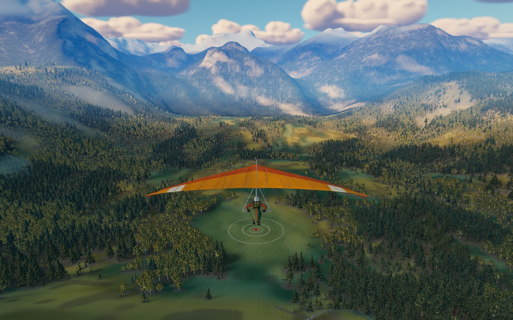
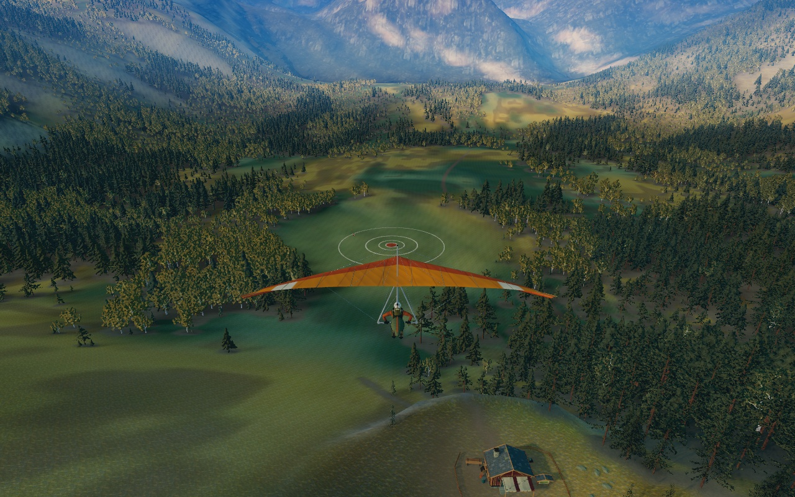
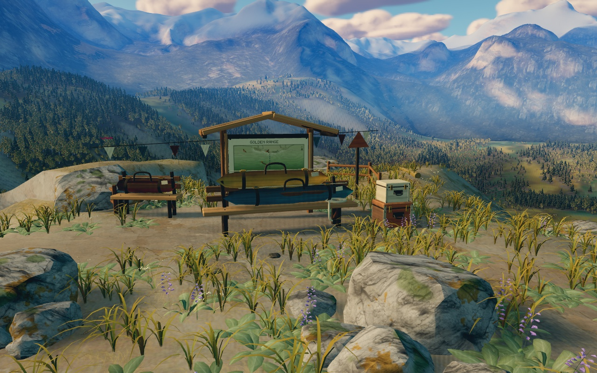
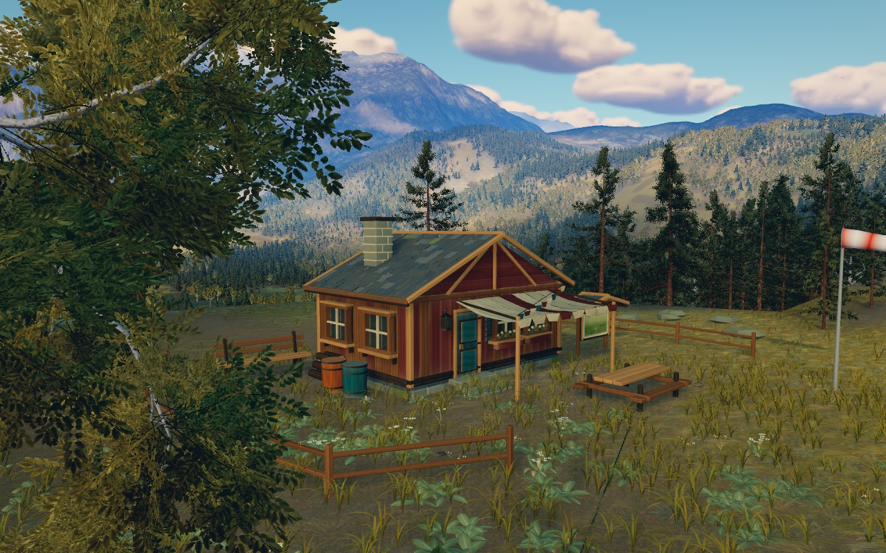
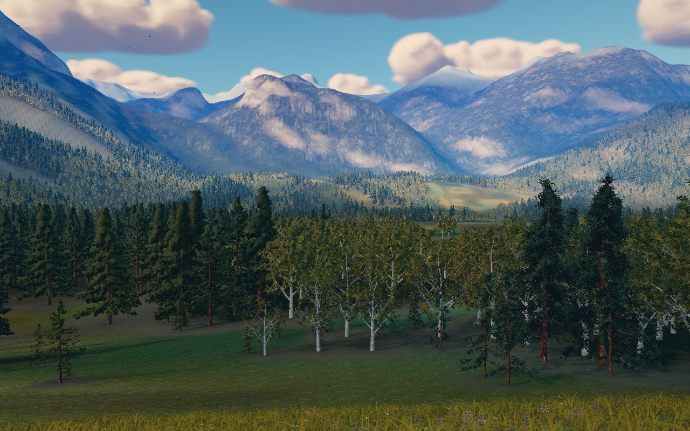
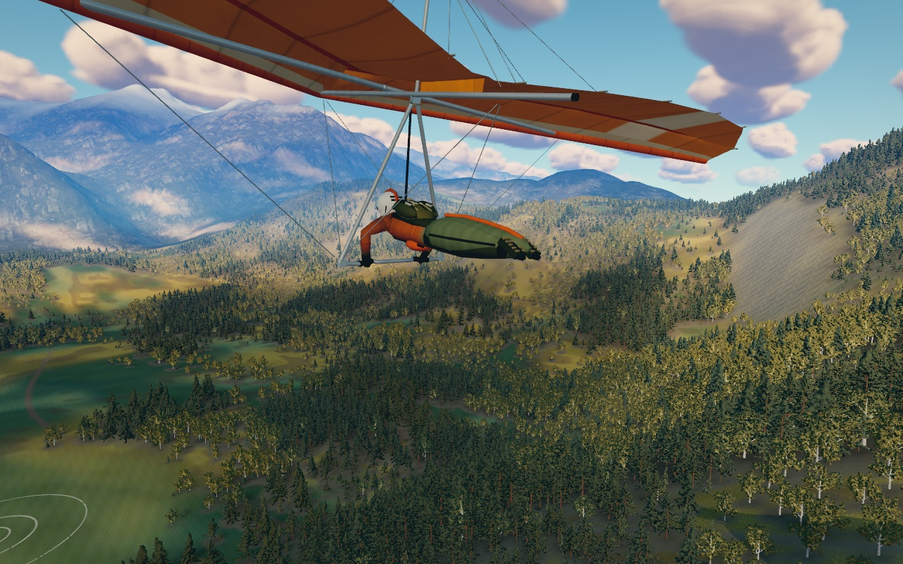

# Golden Range — alpine scene

The scene is built around the orange sail, golden meadow, weathered launch kit,
lichen-covered rocks and snowy mountain layers of the [concept](concept/illustrated-alpine-polish.png).
The images below are actual in-game renders; the concept remains a separate image.

## Current game captures








High quality, 1280×800, local Chromium. Departure and approach use the production chase camera;
other views use inspection cameras. All use the actual geometry, material, shadows,
streaming and finishing path. These screenshots are not painted over or image-generated.

```sh
node server.mjs 4281
CHROME_PATH=/path/to/chromium node tools/range-capture.mjs \
  --url http://127.0.0.1:4281 --view staging,refuge,meadow,departure,approach,aircraft \
  --quality high --out work/alpine-gallery
```

## Rebuilt scene

- The launch preparation area is a worn shelf with rounded shoulders, shared
  render/contact triangles and nearby clustered boulders. Rock footprints keep
  the streamed plants from growing through them.
- Curved grass and inexpensive distant cover form a continuous meadow band out
  to 110 metres at high quality. Upward-biased normals and shadow-aware leaf
  lighting avoid alternating dark blade strips. Yarrow and salvia give white and
  purple accents; deciduous groups break up the conifers.
- The cabin has recessed glazing, sill and frame depth, individually laid slate,
  exposed rafters, door hardware, a log stack and a sagging canvas awning. These
  details are merged by material to keep the prop kit at twelve drawing batches.
  A contour map of the actual terrain replaces the placeholder board. Bags have
  curved cloth, handles, seams and buckles; cases have lids, metal corners and
  clasps. Timber has weathering and relief, and roofs have overlapping slate.
- The refuge now sits on the right side of the descent at (-76,-360), on a level physical terrace with a stone
  retaining foundation. One shared trail layout drives paths, plant clearances
  and the route maps.
- Warm afternoon light faces the visible foreground. Compact cloud banks leave
  gaps in the sky. Sheltered snow accumulation and a sharper real Sierra Nevada
  elevation asset replace the broad Yosemite skyline. Source and explicitly
  interpolated void areas are retained in the [terrain provenance](../range/assets/terrain/SIERRA.md).
- Six-metre botanical texture scale connects ground detail with the actual plants.
  Oblique rock fractures and continuous cliff texture blending avoid cubic rocks
  and visible projection seams.
- The glider uses an orange upper sail, ivory wing flashes and underside, with
  sewn panel detail and tension folds. Warm jacket sleeves, an olive harness,
  webbing, buckles, helmet ventilation and boot soles distinguish the pilot's
  equipment. Equipment follows the existing bones through flight and launch.

[Applied research and scene decisions](research/scene-rebuild.md) links inspected
Three.js projects, asset sources and component-level license notes. The new kit
and shaders are original implementations informed by those references. Existing
local scanned materials retain their attribution and licenses.

Further implementation notes cover [vegetation](research/botany-polish.md),
[forest modelling](research/forest-polish.md), [cabin details](research/prop-polish.md),
[rock lighting and mineral surfaces](research/geology-polish.md),
[clouds and atmosphere](research/lighting-polish.md), and
[aircraft finishing](research/aircraft-polish.md). The previous accepted
[rebuild captures](graphics/alpine-rebuild/validation.md) remain available for comparison.

The animated glider rig, force parameters, target and authored launch inputs are
retained. The launch contact tests compare the exact rendered triangles. Props
remain decorative and outside the central flight/landing clearances.

## Verification and limits

[Capture metadata and checks](graphics/alpine-polish/validation.md) record the
reviewed revision. Visual screenshots and functional replay do not establish
native GPU performance. Dense cover adds geometry; the cloud environment uses
CPU-rendered SwiftShader, and native-device profiling remains necessary.

```sh
python3 tools/build-sierra-terrain.py
python3 tools/build-surface-textures.py
npm test
node tools/range-check.mjs --quality low --deterministic
node tools/range-visual-check.mjs
```
