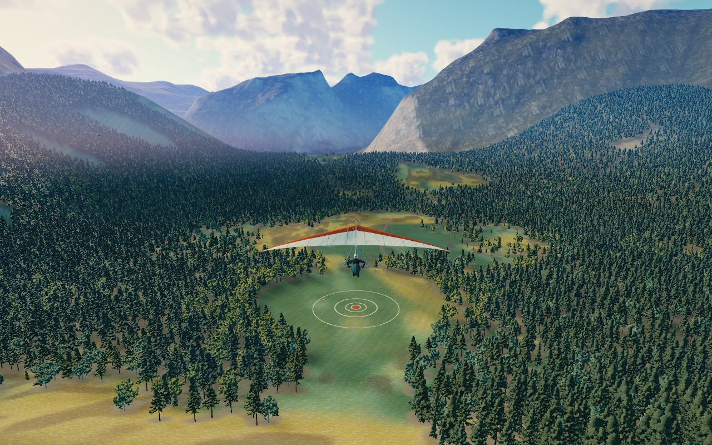
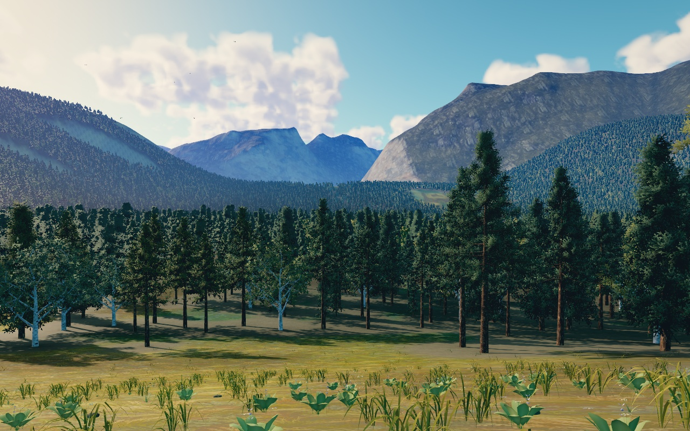
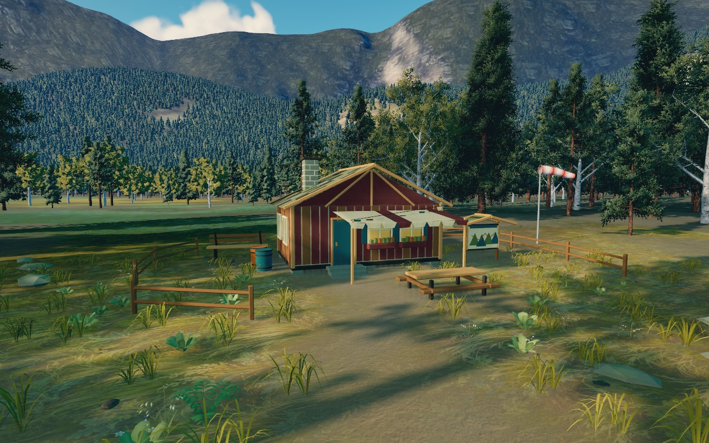
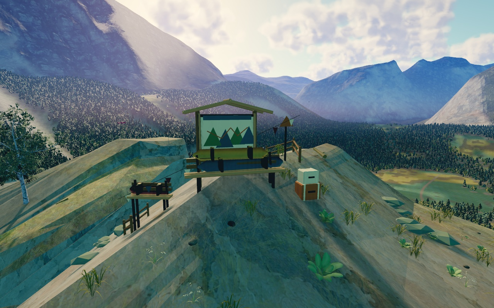
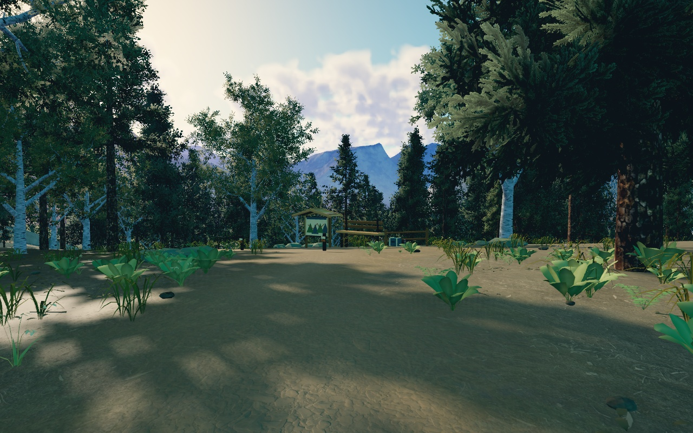
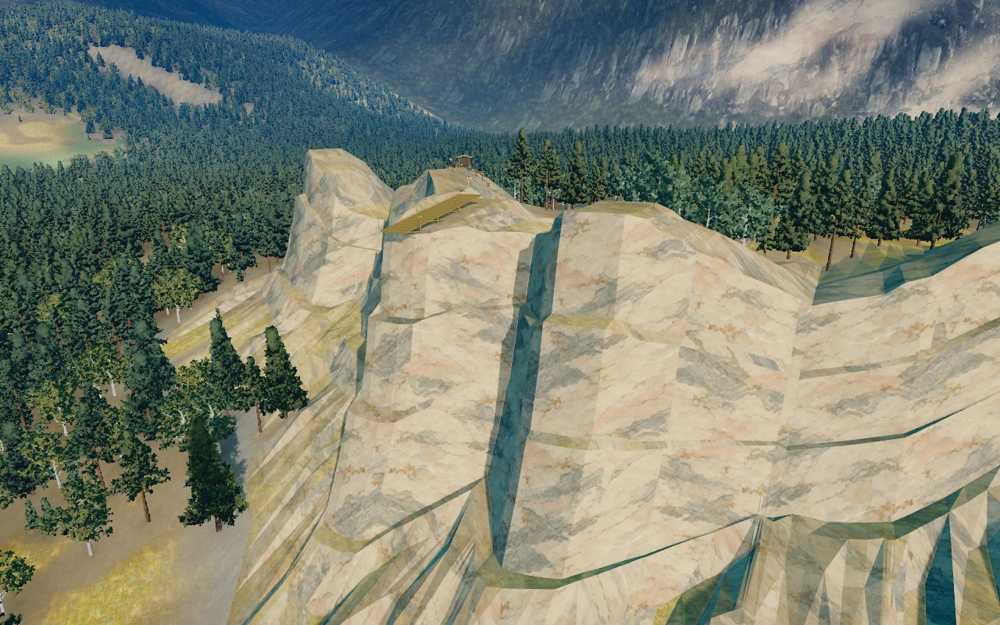
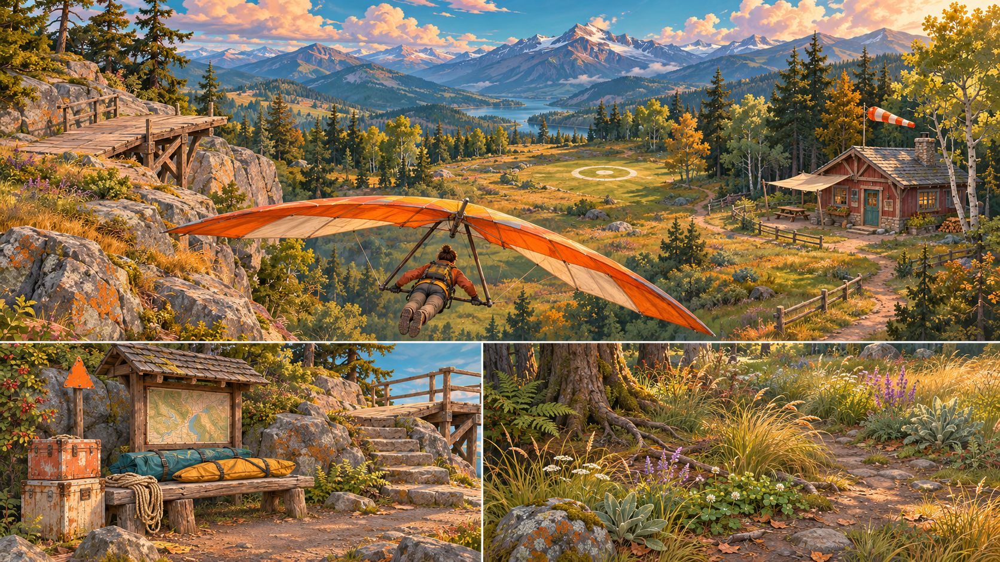

# Golden Range

An illustrated alpine flying place: honey-coloured light, cool teal woodland,
slate-blue mountain layers, sage/ochre meadows and worn ivory, rust and burgundy
gear. The visual target is a coherent outdoor adventure game with readable,
crafted forms. Generated artwork and in-game rendering are identified separately.

## In-game review

Actual Chromium canvas captures, fixed high quality at 1280×800, using the game's
materials, culling, streaming, shadows and output pipeline:








[Previous flight view](graphics/flight-corridor.jpg) ·
[Previous meadow](graphics/meadow-corridor.jpg) ·
[Capture metadata](graphics/golden-captures.json).

Reproduce all six views with one browser:

```sh
npm start
node tools/range-capture.mjs --view flight,meadow,refuge,staging,woodland,launch --out work/gallery
```

Flight frames the actual aircraft. Other views are inspection cameras with the
player hidden. Capture freezes the game after loading and uses production ticks
for the pose; it does not queue unnecessary frames while inspecting software GPU
output. Camera changes update the same detail/finishing path as gameplay.

## Concept and palette

The new concept was generated before the new forms and material artwork:



`range/art-direction.js` owns the afternoon sun and finishing palette. The
roughly 27° warm key is shared by sky, clouds, surfaces and the sky-derived SH/IBL.
Colour grading follows the single tone map and precedes display encoding: cool
open shadows, restrained warm highlights, moderate saturation and a subtle frame
falloff. High/medium also have a bounded four-tap bright highlight glow. Low keeps
the same grade while skipping AO and glow; devices without floating colour
buffers retain the authored material/light palette through direct rendering.

The sky uses cyan-blue gaps, cream/apricot scattering and slate/lavender distance.
This is an authored scene-referred palette, not calibrated radiometric data.

## Ground that belongs to the plants

`surface-style.js` is one pure world-space source for sage, olive, straw, ochre
and umber regions, moisture, mowing and worn soil interruptions. The surface
baker and runtime plant placement call it directly. Large 18–150m patches carry
variation beyond individual grass geometry; warped botanical brushwork supplies
smaller structure. Matte painted granite keeps real geometric facets, softened
normal detail and lichen/soil pockets. Forest floor stays readable warm umber.

Both painted botanical/mineral sources are original generated artwork, retained
with their manifests. Scanned normal/roughness companions and soil inputs retain
their original licenses. Three obsolete colour/roughness images are no longer
requested; the painted world field adds no per-fragment fetches to the previous
meadow blend. Control maps stay opaque linear RGB, paint is sRGB, and source hashes
include world, geology, style and the pure site layout.

Near cover combines drooping six-span grass fans, folded sage/herb masses,
ferns, small flowers, oat heads, litter and deadwood. Six-metre cached cells
stream bounded instance buffers. A separate inexpensive 12m-cell fan layer bridges
20–75 m at high quality, with complementary near/far fades and its own 256-cell
cache. Plant pigment and thinning follow visible terrain regions instead of
independent random colours. The target, paths and occupied prop footprints stay
clear; tree clearings still allow irregular grass islands around the yard.

## Composed places and canopy

Four original prop clusters establish a used flying range: a launch bench with
folded wing bags and route board, a refuge with awning/picnic/gear yard, a meadow
entrance and a woodland rest. Timber and painted cases have bevelled edges,
shared procedural grain/paint wear, faded canvas, angular lichen stones and
wind-driven bunting. The refuge's windsock uses the real wind indicator system.
The kit has 11 material/instance submissions and stays outside the complete 150m
landing field and launch wing/run envelope. It is decorative, not collision data.

`alpine-sites.js` is the shared, pure layout/occupancy source. Geometry refinements
therefore do not invalidate painted terrain. `alpine-set-dressing.js` owns the kit,
its resource lifetime and quality culling. The old prop library is no longer on
the startup path; it remains available for authoring/reference tests.

The forest retains four full-crown forms with near/mid meshes and 32 albedo/normal
views including overhead. Stable grove palettes distinguish sage/gold edges from
cooler inner conifers, with bark protected from foliage tints. Culling uses actual
rotated crown bounds; cells submit front to back and upload only populated
instance-buffer prefixes.

Distant texture mipmaps are authored per atlas tile. Filtering uses alpha-weighted
linear albedo, normalized normals, transparent RGB padding and preserved cutout
coverage. Gzip chains stop at one texel per view; native browser decompression
loads them without third-party runtime libraries. PNG atlases remain a tested
fallback. Selecting one consistent view for each tree removes per-pixel view
speckle, while retaining eight azimuths/four elevations and runtime lighting.
See the forest README and mip diagnostics for measurements and rebuild details.

## Shared physical world

The connected escarpment's Float32 triangles are shared by rendering and indexed
contact queries. Physical clearance, camera avoidance and landing cues include
real rock. Ridge airflow samples the broad hillside through its existing separate
surface callback. The terrain retains its full 240×240 grid at every quality.
This art pass changes no height source, force parameters, authored launch starts,
landing field or glider bones.

The 14 km public-domain USGS Yosemite crop remains the backdrop with stitched LOD
patches. Source voids remain marked as interpolated; surface artwork makes no new
survey claim. The 19-bone glider keeps its rig, attachment metadata and flutter.

## Rebuild and validation

All runtime files are local. The game needs Node and a browser; Chromium,
Blender or Python/NumPy/Pillow/SciPy are authoring tools only. Exact immutable
inputs, MIT/CC BY/CC0/public-domain notices and checksums stay beside the assets.

```sh
node tools/build-forest-assets.mjs --fetch-textures --geometry --bake
node tools/build-forest-assets.mjs --mips
node tools/build-forest-assets.mjs --verify
python3 tools/build-surface-textures.py
npm test
node tools/range-check.mjs --quality low --deterministic
node tools/range-visual-check.mjs
```

[Validation and measurements](graphics/validation.md) retain functional results,
software renderer limits and the unverified native GPU target. The
[twenty-project research](research/threejs-2026.md) remains the quality reference;
these captures do not claim commercial production-art or 1080p/60 parity.
