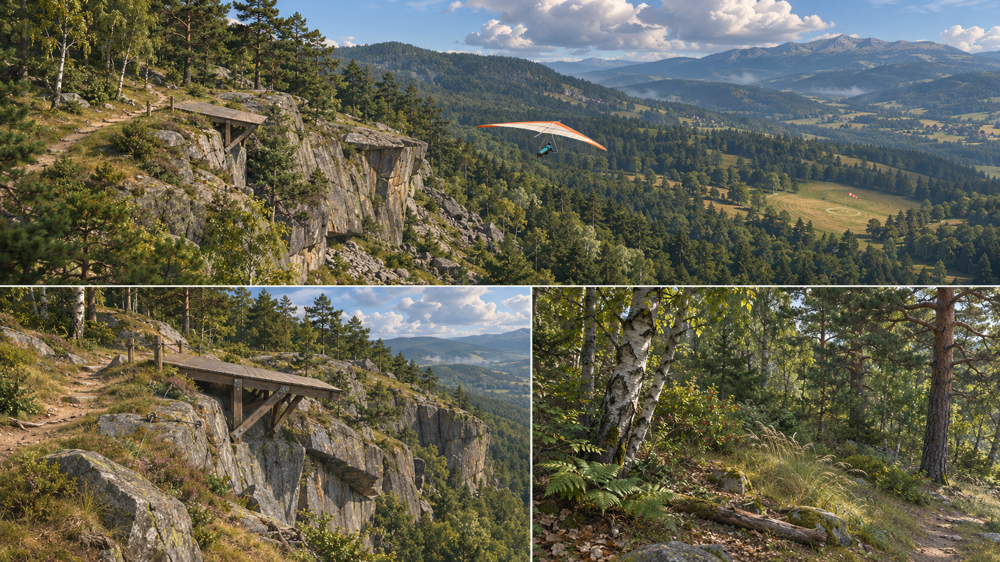
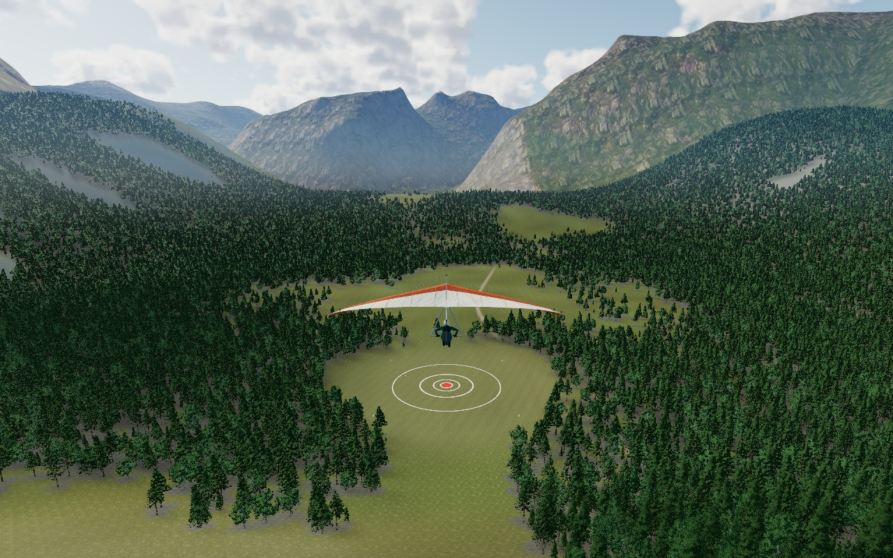
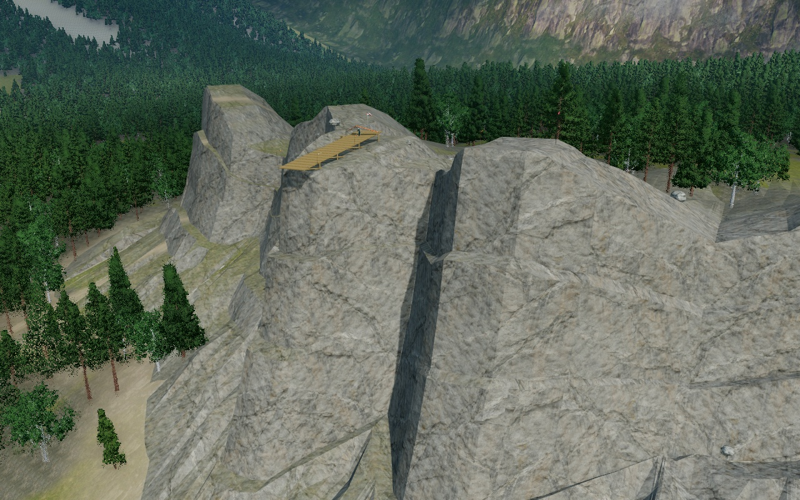
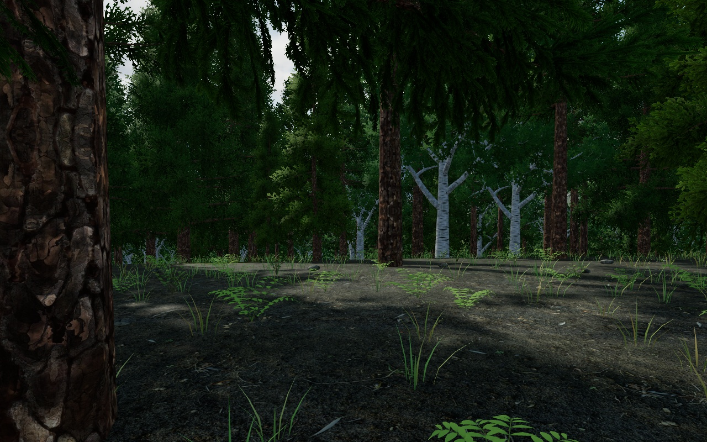
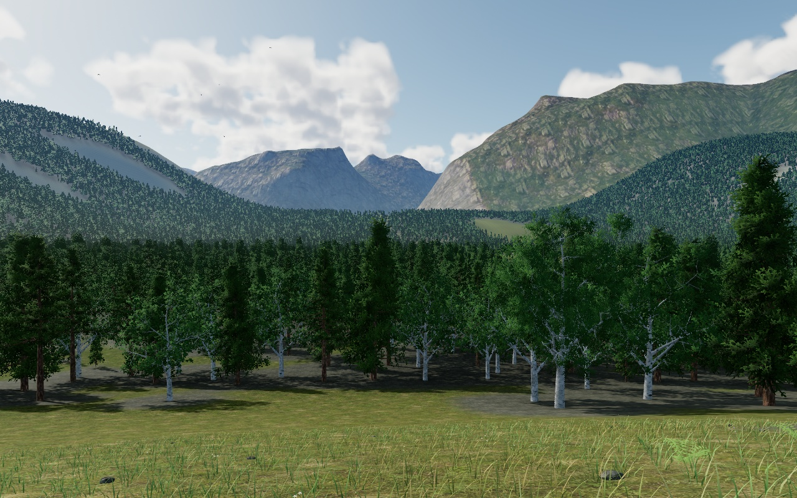

# Above: an alpine flight corridor

The [twenty-project research](research/threejs-2026.md) raised the target from the
initial graphics baseline. This implementation concentrates on the launch,
woodland and landing route. The new concept was generated **before** replacing
the forms and remains separate from the in-engine captures below.



## Actual game captures

Fixed high quality, 1280×800, using the production renderer. These are browser
canvas captures, not concept paintings or offline beauty renders.






Start `npm start`, then reproduce the views with:

```sh
node tools/range-capture.mjs --view flight --out work/flight.jpg
node tools/range-capture.mjs --view launch --out work/launch.jpg
node tools/range-capture.mjs --view woodland --out work/woodland.jpg
node tools/range-capture.mjs --view meadow --out work/meadow.jpg
```

Flight uses an inspection chase framing of the actual aircraft. Other views move
only the camera. All update the same forest culling, terrain LOD, streamed cover,
cloud prepass and final rendering as gameplay. The capture tools disable source
refresh so a frame cannot change revisions while assets are being authored.

## Shared world and natural forms

`world.js` owns the physical world. `launch-geology.js` produces one connected
Float32 triangle pack: broken crest, asymmetric slabs, interrupted joints,
weathered apron and angular toe. Rendering consumes those exact triangles;
`rockSurfaceAt` queries them through a spatial index. Physical ground, launch
clearance, chase-camera avoidance and landing cues include the actual rock. Ridge
airflow samples the broad hillside; the existing separate surface callback supplies
exact local clearance, preventing slab edges from changing launch airflow.
The deck and cliff standing heights remain authored constants. A narrow natural
spur supports the deck, leaving a short braced overhang rather than long stilts.
The surrounding terrain retains its full **240×240** grid at every quality.

The backdrop retains the 14 km public-domain USGS Yosemite crop with 48 stitched
LOD patches. Its 9.1% source voids remain explicitly marked as interpolated.
Peripheral relief and the launch shoulder change the physical landscape. The
landing field, launch starts and protected thermal retain their established
heights; exposed new rock faces and their toe are intentionally solid.

`sampleTerrainEcology` supplies rock, talus, moisture and path masks to both
surface authoring and runtime placement. The control baker calls this canonical
module and records source hashes. Tests reject stale masks after world edits.
Photographic meadow, soil, needle-floor, timber and mineral PBR maps blend with
larger botanical artwork and geological structure. Cliff surfaces keep their
geometry normals; upward soil/lichen pockets soften the bare crest. Generated
artwork and captured scans are identified separately in the asset manifests.

## Forest and ground cover

`forest-field.js` plants roughly **63,600** deterministic trees across 3 km of
valley while keeping the run, flight corridor and landing meadow clear. Warped
woodland margins, four species/age forms and varied scales break regular rows.
Actual crown footprints produce one coverage texture and matching CPU sampler;
forest-floor shading, ferns, shrubs and litter therefore follow the real stand.

The new tree pack derives from pinned MIT EZ-Tree source and attributed package
textures. Each tree has full and reduced meshes from the same branch skeleton,
plus **32 albedo/normal views**: eight azimuths at 0°, 30°, 60° and true overhead.
Impostors remain physically lit, reconstruct tree-local normals with original
yaw, and choose views from the actual perspective or shadow camera. Explicit
texture gradients prevent atlas-frame changes from selecting incorrect mips.

`forest.js` culls spatial cells before individual crowns and uses three levels
with screen dither transitions. High near/mid boundaries are 55/125 m; medium
35/85 m; low 18/45 m. Original transforms stay fixed; billboard orientation is
computed on the GPU. Only populated instance-buffer prefixes are uploaded.
Near/mid meshes cast real shadows; distant canopy grounding uses an approximate
static sun-aligned map from the same trees.

Ground detail streams repeatable six-metre world cells into bounded buffers:
bowed grass, small flowers, stones, fern rosettes, woody shrubs, litter and
fallen branches. A 384-cell cache reuses samples at cell boundaries. Detail
suspends above 60 m ground clearance. Small launch hardware, rope and trail
furniture are merged by material and stay outside the run and wing envelope.

The props-only startup GLB is **267,728 bytes**, 95.35% smaller than its original
5,756,672-byte library; obsolete trees and their atlas are no longer loaded.
The glider retains its model, skin weights, attachment metadata, 19-bone rig,
flight forces and animation hooks.

## Daylight and frame budgets

`aerial-atmosphere.js` shares one fixed sun across the scattering sky, spectral
height-dependent aerial perspective, cloud volume and direct-light shadows.
Surface transmission and inscattering interpolate from vertices to reduce repeated
work on overlapping foliage; cloud shadows remain per fragment. A small linear
radiance bake from that same sky supplies diffuse SH and selective
PMREM metal reflections. The directional sun is excluded from the probe to avoid
double-counting it. The former 21 MB HDR is no longer on the startup path.

Clouds use one deterministic 3D density field and matching sun-column shadow
volume. High marches at one-third resolution, capped 640×360/48 steps; medium
one-quarter, 480×270/32; low one-sixth, 256×144/16. They share world-space wind
and an authored initial offset. This is a bounded approximation, without temporal
cloud reconstruction or measured physical radiometric calibration.

High/medium retain HDR colour and alpha-aware beauty depth with contact AO and
one output tone-map. High AO uses 12 half-resolution samples/9-tap resolve;
medium uses 8 at one-third resolution/5-tap resolve. Low renders directly.
Adaptive quality changes render work, never the physical terrain or flight clock.
Use `?quality=high`, `medium` or `low` to hold a preset; default is `auto`.

[Validation and measurements](graphics/validation.md) separate implemented work,
software-renderer observations and the still-unverified native GPU target. The
research's commercial-art and 1080p/60 targets remain review criteria, not claims
that this draft has reached production parity.

## Rebuild and provenance

All runtime assets are local. Exact sources, immutable checksums and license
notices live beside the assets. Babylon surfaces are CC BY 4.0; the scanned CC0
materials, Poly Haven inputs and public-domain DEM retain their own notices.
EZ-Tree code/leaves/package bark are attributed under its MIT package license;
unknown bark is not relabelled as ambientCG CC0. Both generated concept and
meadow originals are retained in `docs/concept/`.

```sh
node tools/build-forest-assets.mjs --fetch-textures --geometry --bake
node tools/build-forest-assets.mjs --verify
node tools/extract-environment-props.mjs
python3 tools/fetch-scanned-materials.py
python3 tools/build-surface-textures.py
python3 tools/build-alpine-terrain.py
blender --background --python-exit-code 1 --python tools/build-alpine-assets.py
```

Node and a browser run the game. Chromium, Blender or Python/NumPy/Pillow/SciPy
are authoring-only dependencies; see each builder's documented options.
