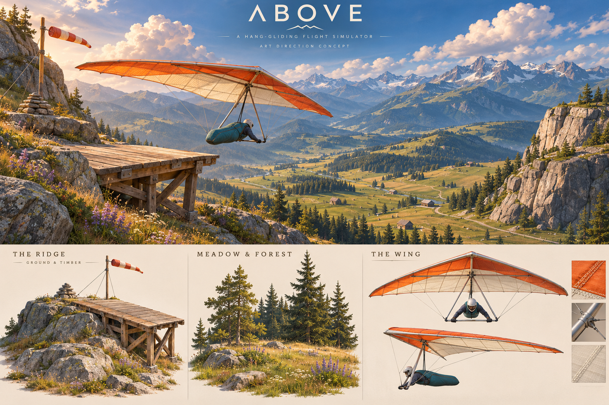
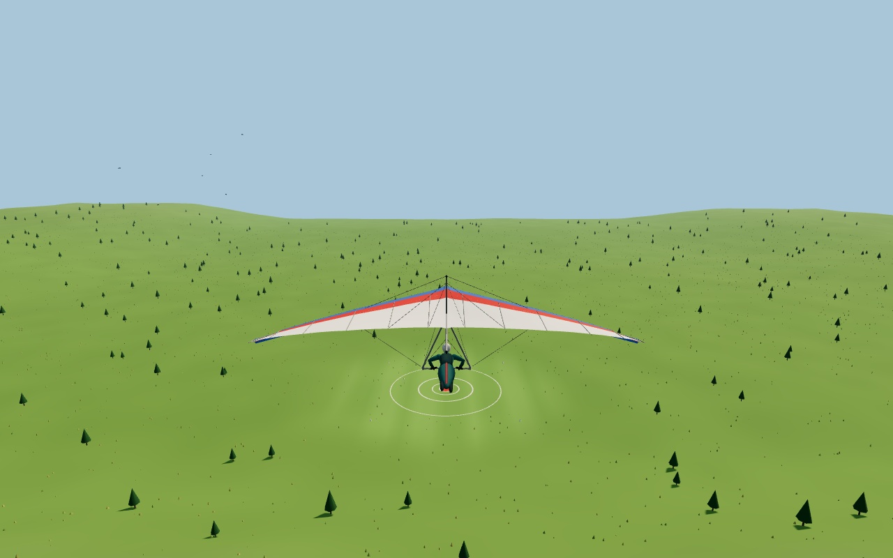
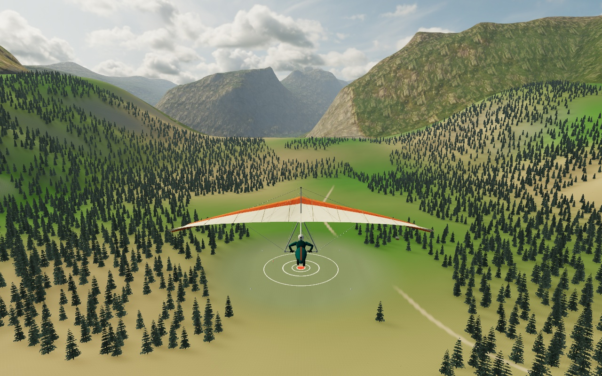
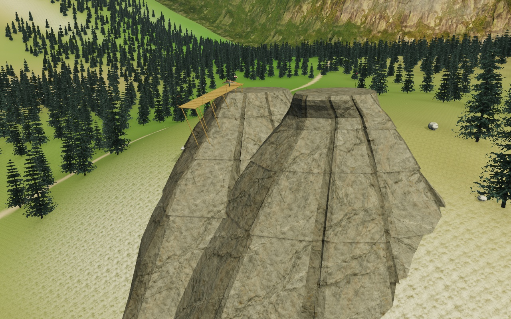
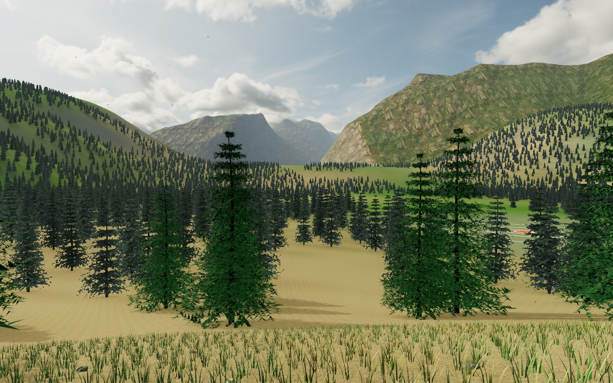

# Above: an alpine flying range

The generated concept sheet established the palette before the environment models
were built: warm daylight, granite, spruce, weathered timber, ivory/orange sailcloth
and a teal harness.



## In the game

These are Chromium canvas captures of the actual Three.js scene at fixed high
detail; the HUD is omitted. The launch, glider rig,
flight model and HUD remain playable; the images are not offline beauty renders.

| Before | Updated range |
| --- | --- |
|  |  |





The goal is a substantial step toward a convincing outdoor game environment.
These captures demonstrate the implementation; they do not establish parity with
a particular commercial game's production art or performance on a discrete GPU.

To reproduce the views, start `npm start`, then run (Chrome/Chromium required):

```sh
node tools/range-capture.mjs --view flight --out work/flight.jpg
node tools/range-capture.mjs --view launch --out work/launch.jpg
node tools/range-capture.mjs --view meadow --out work/meadow.jpg
```

The flight view uses the chase camera; launch and meadow are inspection cameras.
They share the game's culling, detail streaming and final rendering path.

## Landscape and surfaces

The backdrop uses a 14 km crop of public-domain USGS Yosemite elevation data.
Its 513² height samples preserve real drainage and escarpments. The original
source has missing samples: 9.1% of the crop is harmonically interpolated, with
the uncertainty mask retained beside the data. Forty-eight patches use stitched
64/32/16 grids for culling and geometry LOD. The decorative skirt stays below the
playable world, including triangle interiors at its square corners.

Within the playable world, asymmetric peripheral shoulders and drainage cuts
provide relief around the approach. A shared physical shoulder joins the launch
outcrops back into the ridge, leaving approximately 15 m and 23 m exposed ledges.
**This changes flyable terrain at the valley margins and beneath the launch.**
The deck and cliff-cap elevations, landing field, forward approach and thermal's
protected area retain their previous heights. Both rendering and simulation use
`world.js`; the terrain keeps its full 240×240 grid at every quality.

Photographic grass, soil, granite, timber and aerial rock PBR maps supply colour,
normal and roughness detail. World projection keeps rock scale consistent on
UV-less cliff meshes; slope and broad cover masks blend grass, earth and stone.
An image-generated granite macro map adds larger fracture structure, explicitly
credited as synthesized. Source licenses, immutable revisions and checksums live
beside the assets. Babylon assets are CC BY 4.0; CC0Textures and Poly Haven assets
are CC0. All runtime files are local, with no asset-service requests.

## Forest, ground cover and launch

Approximately 12,500 seeded spruces form connected forest belts. Three original
Blender variants have individual needle and woody branch geometry nearby; more
distant trees use alpha-tested two-triangle cards selecting four baked views.
Nine shared instance batches, per-tree frustum tests and distance LOD bound the
forest's submissions. A static canopy/contact visibility map grounds the actual
planted trees and follows the sun azimuth. The approach and field remain open.

The near meadow streams deterministic six-metre cells into three fixed instance
buffers: curved grass ribbons, small wildflowers and pebbles. Quality controls
35/25/15 m radii and 5,000/2,400/750 tuft budgets. Shader wind and edge shrinking
avoid reshuffling the world; detail suspends above 60 m terrain clearance.

Launch rocks have broken ledges, long vertical joints and chipped rims. Their
visible shells enclose the existing rock collision inset, while the usable tops
remain level. Original boulders, cairns, signage, equipment and refuge models
provide scale. Timber planks, beams and metal fittings use separate finishes; static timber is
batched by material to reduce colour and shadow submissions.

The glider keeps its existing model, positions, skin weights, attachment metadata
and 19 bones. Projected UVs add fabric weave, seams, roughness and metal finishes.
The rig and sail flutter retain their existing animation hooks.

## Light and rendering

A genuine 4K CC0 photographic HDR panorama supplies both the sky and lighting.
The lighting copy is reduced in linear radiance to 1K. A nine-coefficient
spherical-harmonic probe supplies diffuse sky light to rough world surfaces; a
bounded 256 PMREM supplies aircraft and metal reflections. This avoids expensive
reflection lookups across the landscape. Sun direction and colour are measured
from that same source. Concentrated
shadow bounds improve contact precision around the aircraft and launch.

High and medium quality render HDR colour and depth together, then apply restrained
half-resolution contact occlusion and output tone mapping. Reusing the beauty
pass depth preserves the actual foliage alpha cutouts. Low quality uses direct
rendering. Adaptive quality controls resolution, shadows, vegetation and effect
budgets and texture anisotropy. Fine normal/roughness detail fades with distance;
large geological structure and the original surface maps remain present. `?quality=high`, `medium` or
`low` holds a detail level; the default is `auto`.

Optional asset failures leave a flyable procedural fallback. Tests cover the rig,
full-detail terrain alignment, protected flight-space heights, LOD seams, actual
triangle clearance, atlas/culling budgets, grounded instances and render-state
restoration. Browser checks exercise both launches, realistic takeoff, posture
changes and landing judgment. [Validation and rendering measurements](graphics/validation.md)
record the checks and current performance limitations.

## Rebuilding assets

The game needs only Node and a browser. Rebuilding authoring assets additionally
requires Blender, ImageMagick, or Python with NumPy, Pillow and SciPy:

```sh
blender --background --python-exit-code 1 --python tools/build-alpine-assets.py
python3 tools/build-alpine-terrain.py
python3 tools/build-surface-textures.py
python3 tools/fetch-scanned-materials.py
bash tools/build-granite-macro.sh
```

See each asset directory's README and credits for exact inputs, licenses and
regeneration commands. The concept original is retained in `docs/concept/`.
