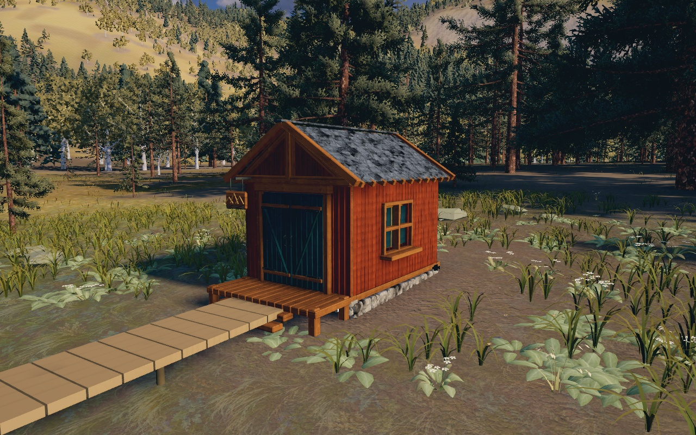
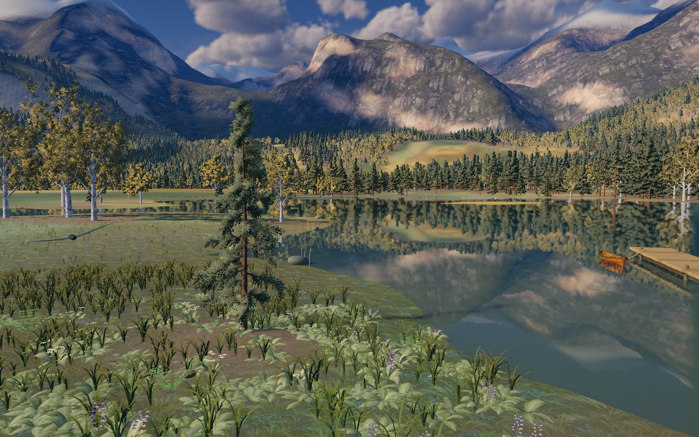
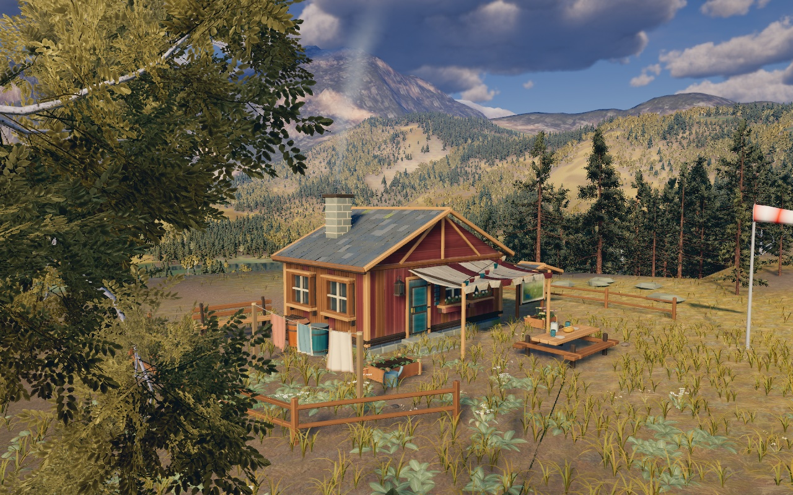
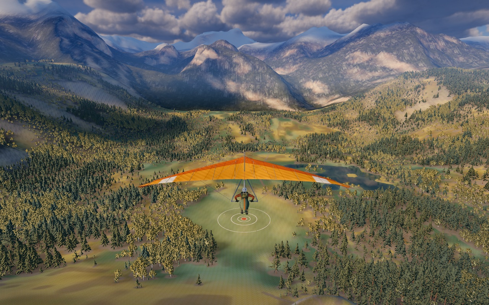

# Living valley

The valley now has a destination beyond the landing field: a shallow tarn, a
timber boathouse and a moored rowboat. Small signs of use at the refuge, restrained
wildlife and spatial sound connect those places. The atmospheric work replaces
the smooth local cloud shapes with a locally bundled Takram WebGL2 provider while
retaining the game's renderer, materials and flight model.

The subsequent [ground material pass](terrain-art.md) refines the near/far terrain
and includes the latest comparison gallery. The images below preserve this living-valley checkpoint.

The images below are actual 1280×800 production-renderer captures. The
[alpine concept](concept/illustrated-alpine-polish.png),
[boathouse concept](concept/lakeside-boathouse.png) and
[Cycles model preview](../range/assets/lakeside/model-preview.png) are separate
authoring references, not game screenshots.






Departure uses the gameplay chase camera; the other images use inspection cameras
with the same production geometry, materials, culling and finishing. Cloud history
is warmed for 32 frames after camera cuts. Compare the same departure in
[late sun](graphics/living-valley/late-sun.jpg) and
[clear day](graphics/living-valley/clear-day.jpg).

## Places and movement

Willow Tarn occupies a connected western depression at water level 2.15 m. Its
roughly 55,039 m² surface is shallow, with maximum depth about 1.04 m. The water
mesh clips against the existing 240-cell Float32 terrain triangles, so the shore
follows the drawn ground. Flood filling selects connected wet triangles; the
landing field and isolated depressions remain dry. A shared lake exclusion masks
ordinary trees and meadow cover near the water. The route boards now include the
tarn and the footpath from the refuge.

A separate, directional tree clearing opens sunlight onto the boathouse roof and
window wall. It retains the ground plants and the rear/side forest framing.

The boathouse stands beside a boarded jetty, shore stones and moving reeds. The
boat's waterline root attaches to one animated anchor, with restrained heave and
roll. Water uses depth-dependent bed color, absorption, ripple normals and a
bounded planar scene reflection. These are visual effects: the tarn adds no
swimming, buoyancy or new water-contact rules to the flight simulation.

At the refuge, smoke rises from the existing chimney, linen moves on a sagging
clothesline, herbs and flowers occupy raised beds, and mugs, bread and a pot sit
on the picnic table. These details use the existing ground and furniture anchors
rather than introducing another building footprint. Six modeled raptors retain
the thermal's visual cue; a few swallows and small butterflies remain local to
the shore and flowerbeds. Their motion is decorative.

Woodland rustle, sparse bird phrases, shoreline wash and an occasional subdued
refuge knock come from the existing user-unlocked audio context. Distance,
altitude and listener orientation shape their volume and stereo position. This
is original procedural synthesis, not recorded wildlife or a continuous musical
track. The layer shares the game's mute, pause and flight-speed ducking controls.

## Blender and PBR authoring

The boathouse and boat were actually authored in **Blender 4.3.2**, following the
focused concept. [build-lakeside-assets.py](../tools/build-lakeside-assets.py)
constructs separate boards, bevels, recessed window openings, rafters, slate,
hardware, footings and an open clinker hull with curved overlapping strakes,
ribs, thwarts and oars. UV coordinates, normals and material assignments are
exported with the geometry. This is modeled construction, not a concept image
projected onto a simple box.

The editable [lakeside.blend](../range/assets/lakeside/lakeside.blend) packs its
textures and includes a review camera and light. The production
[lakeside.glb](../range/assets/lakeside/lakeside.glb) uses metres and Y-up, with
named house-floor and boat-waterline roots. Meshes are merged by material and root
for **39,420 triangles across 17 mesh batches**. The 48-sample CPU Cycles preview
is an asset review; the game uses its own real-time lighting and tone mapping.

Wood and stone materials derive from the already retained Planks21/Rock26
photographic albedo, normal and roughness maps. The builder resizes them to
512×512, preserves photographed grain/luminance while applying recorded paint
pigments, and renormalizes the tangent-space normals. The GLB embeds those PBR
textures. The [asset README](../range/assets/lakeside/README.md) and
[manifest](../range/assets/lakeside/manifest.json) retain source hashes, transforms
and the upstream CC0-package qualification; no independent material authorship
or new scan is claimed.

```sh
blender --background --factory-startup --python tools/build-lakeside-assets.py -- --render
node --test tests/lakeside-models.test.mjs
```

## Cloud and lighting integration

[Takram](research/cloud-shader-options.md) was selected after inspecting current
Three.js implementations and renderer requirements. The game keeps its existing
Three r180 WebGL2 instance. A pinned vanilla bundle provides `CloudsEffect` and
`SkyMaterial`; no React runtime, remote asset service or renderer migration is
introduced. Perlin–Worley shape, smaller erosion, weather coverage, three cloud
layers, optical-depth lighting and temporal filtering replace the previous
uniformly smooth billows.

The same retained Bruneton tables supply the visible clear sky, cloud lighting,
direct-sun color and the radiance used for the diffuse probe and metal reflections.
One scene-linear scale precedes the existing final tone map. Surface materials
read the provider's actual two-cascade cloud shadow map. The adapter also fixes
float cancellation in the source cube-sphere weather projection near this local
world's planet anchor; the same correction applies to density and shadows.

The authored weather offset places the shore, refuge and launch in a sunny
opening instead of starting the whole valley under an opaque cloud. The diffuse
probe has a deliberate 3× art-direction gain to keep the illustrated foreground
readable and approximate missing cloud-scattered light and local bounce. This is
an artistic fill, not a claim of complete light transport; solar energy, visible
sky radiance and specular reflections retain their common unmodified scale.

Terrain and prop aerial extinction still use the game's analytic height integral,
with the provider's sky probe supplying inscatter color. **This is not the full
Bruneton aerial-perspective integral applied to every scene surface.** The cloud
pass uses a far-depth background and ordinary scene geometry occludes it. Flying
inside clouds or placing cloud volume in front of mountains would need actual
scene-depth compositing. Haze and light shafts are currently disabled.

The panel offers afternoon, late sun and clear day. Choosing a condition reloads
the scene, rebuilding probes and shadow resources consistently. The late-sun
choice remains around 18° elevation; it is not a sunset/twilight simulation.
`?clouds=basic` selects the earlier bounded cloud path, also used if the advanced
provider cannot initialize. Optional model failure leaves the lake and dock
available without the imported house/boat.

## Runtime responsibilities and costs

| Module | Responsibility and budget |
| --- | --- |
| [advanced-clouds.js](../range/advanced-clouds.js) | Owns local cloud/LUT textures, cloud history and shadow passes. Output caps are 640×400 / 480×300 / 320×200; camera iteration limits are 240 / 160 / 100 for high/medium/low. Ordinary temporal AA remains active; 4×4 temporal upscaling is disabled after visual comparison. |
| [aerial-atmosphere.js](../range/aerial-atmosphere.js) | Adapts provider or fallback into existing material hooks, shared sky radiance and the background composite. The legacy volume is not allocated alongside the advanced provider. |
| [alpine-waterscape.js](../range/alpine-waterscape.js) | Owns connected shore geometry, water/reeds and boat anchor. One reflected geometry pass is capped at 512×320 high or 320×200 medium, roughly 7/4 updates per second while moving; low disables it. |
| [lakeside-models.js](../range/lakeside-models.js) | Loads and validates the local Blender roots, applies shared lighting and owns imported geometry/materials/textures. The supplied environment map remains caller-owned. |
| [living-refuge.js](../range/living-refuge.js) | Merges static objects, foliage and linen by material; one fixed smoke draw uses 24/18/12 wisps. Animation changes existing uniforms. |
| [valley-wildlife.js](../range/valley-wildlife.js) | Three fixed instance batches and at most 4,382 triangles. Low retains three thermal birds and removes local insects/swallow detail. Wing deformation and normals move together in the shader. |
| [valley-ambience.js](../range/valley-ambience.js) | Reuses the existing audio bus/context. Eleven persistent nodes and at most three short voices; cached synthesized buffers remain below about 1.3 MiB at 48 kHz. |

The water reflection reuses scene LOD and shadows, excludes near ground cover and
the water itself, and clips underwater geometry. It reflects the matching clear
sky but does not reuse the main camera's temporal volumetric-cloud image. Its
lower cadence may become visible during fast camera motion. There is no
screen-space refraction or projected caustic lighting.

The cloud data includes a 2 MiB shape volume and an 8 MiB scattering table, plus
detail/weather/jitter textures and render targets. This improves the medium and
lighting model but increases memory and work relative to the old short march.
The original spatial blue-noise ranks with temporal rotation are not NVIDIA STBN
data and do not claim its joint spatiotemporal spectrum. Temporal cloud history
also needs warmup and can show ghosting around sparse moving clouds.

Native GPU frame time has not been measured. SwiftShader results describe CPU
software rendering, which is slow here; neither screenshots nor third-party
project benchmarks establish 60 FPS for this scene. The independently maintained
flight forces, fixed-step timing and existing terrain contacts are not changed
to compensate for visual cost.

## Sources and verification

The [four strongest project references](research/threejs-frontier.md) distinguish
Takram's atmospheric engineering, Bruno Simon's coordinated art direction,
Nanite Forest's aerial vegetation budgets and the official Three.js temporal
rendering contracts. Only Takram and the separately credited dependencies are
bundled for this cloud integration. Their exact versions, local data hashes,
MIT/Zlib/BSD notices and rebuild commands are in
[the cloud asset documentation](../range/assets/clouds/README.md).

Planar reflection camera and oblique-clipping math follow the MIT-licensed
Three.js r180 Water/Reflector implementation; the source retains that attribution.
The shore, refuge kit, wildlife, model geometry and procedural ambience are
original project work. Detailed decisions are recorded for
[Willow Tarn](research/willow-tarn.md), [refuge life](research/living-refuge.md),
[wildlife](research/valley-wildlife.md) and [ambience](research/valley-ambience.md).

| Integrated validation | Status |
| --- | --- |
| Production gallery and shader/runtime errors | Six high-quality views; zero errors |
| Full automated test suite | 160 passed |
| Launch/landing browser checks | 9 passed |
| Alternate modes, resize and missing-asset fallback checks | 9 passed; cloud failures exercised |
| Quality switching, portrait resize and audio unlock/mute/resume | Passed in Chromium |
| Moving cloud history and audible sound quality | Native-device review remains |
| Native GPU profiling | Not measured |

[Capture metadata and reproduction commands](graphics/living-valley/validation.md)
record the rendering costs and verification limits.
