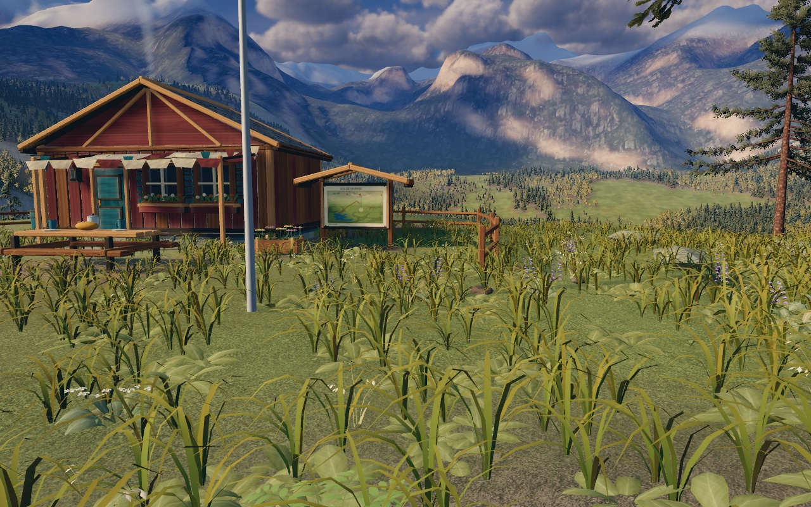
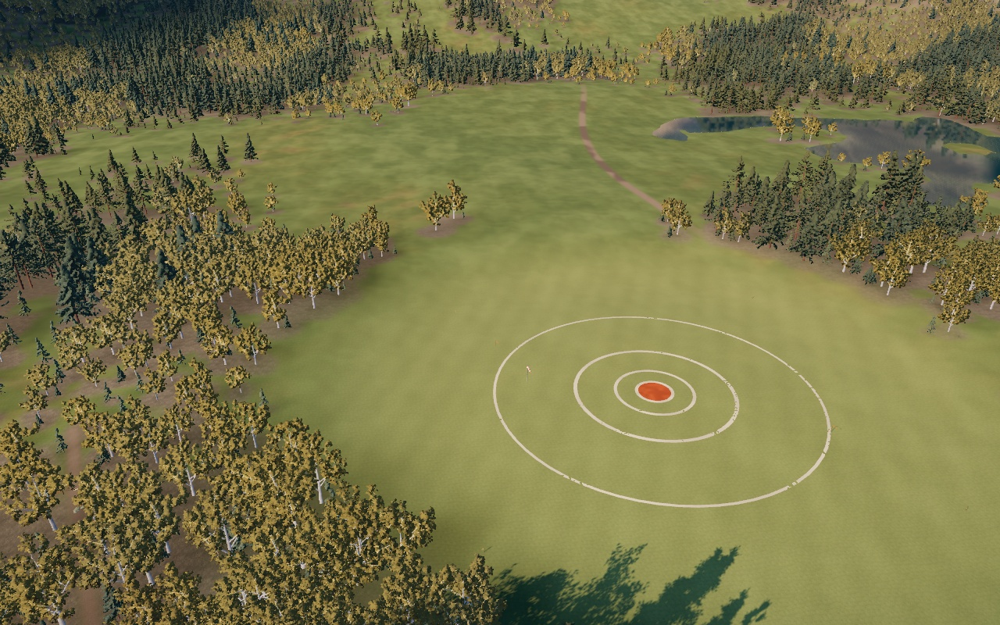
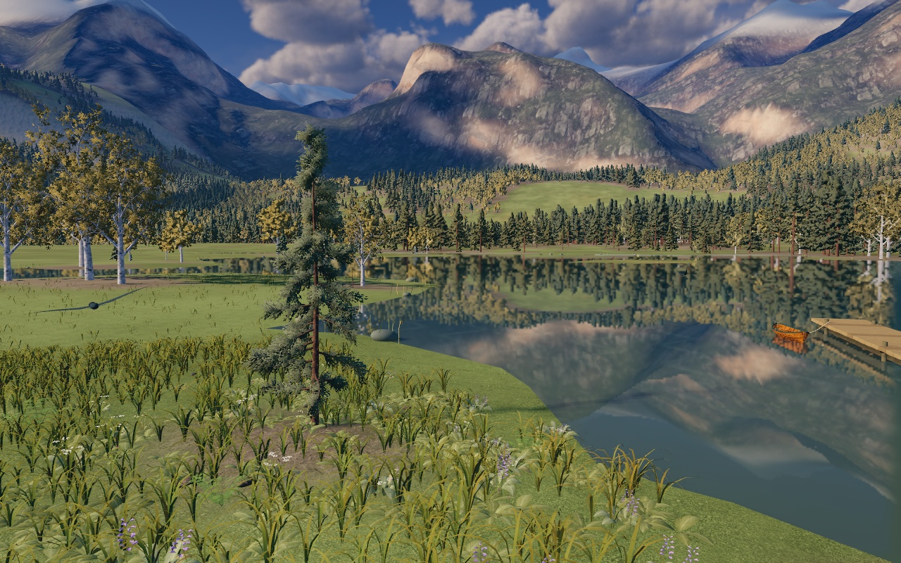
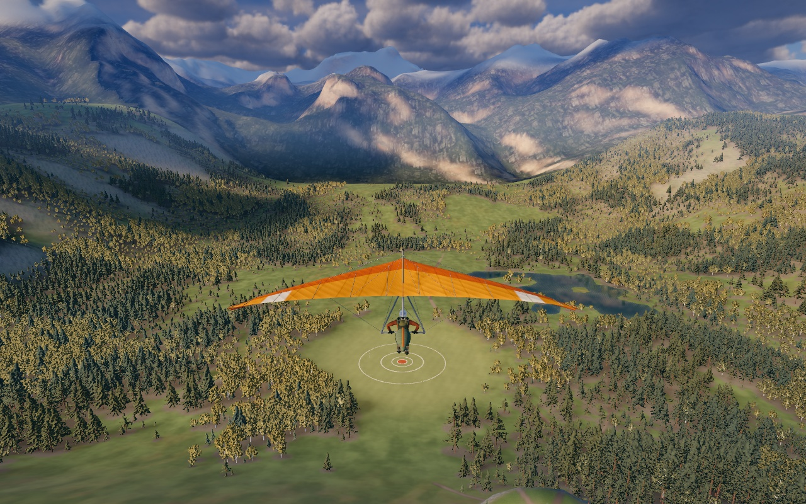

# Ground material and landscape polish

The terrain now separates the valley's overall color composition from close surface detail. A unique world-space pigment atlas supplies meadow communities and wear; registered photographic color/normal companions supply nearby grass, soil, humus and rock grain. Stochastic sampling breaks up repeated source motifs without moving paths, tree coverage or shoreline controls.

The retained gallery uses actual production-renderer captures, with matched ground and aerial views from commit `487a432` for comparison. [Validation and reproduction details](graphics/terrain-polish/validation.md) record the checks and rendering limits.

## Comparison gallery

| View | Before | After |
| --- | --- | --- |
| Ground beside the refuge | [Before ground](graphics/terrain-polish/before-ground.jpg) | [Ground](graphics/terrain-polish/ground.jpg) |
| Valley from moderate flight height | [Before terrain](graphics/terrain-polish/before-terrain.jpg) | [Terrain](graphics/terrain-polish/terrain.jpg) |
| Lakeside grazing view | — | [Lakeside](graphics/terrain-polish/lakeside.jpg) |
| Departure composition | — | [Departure](graphics/terrain-polish/departure.jpg) |

Both revisions use the same camera positions, high quality, 1280×800 resolution and afternoon lighting. The images below are game renders; concept art is separate.






## What changed

[`surface-style.js`](../range/surface-style.js) defines matte ochre, straw, olive, sage, fern, russet and umber pigments in linear RGB. Moisture and mowing guide their composition. The meadow field now uses a connected olive-green grass palette with restrained 6–30 m straw variation, broken edges, a gentle valley-aligned shear and sparse worn pockets. Outer building yards retain grass, while occupied footprints and explicit tracks receive stronger wear. The landing area stays calmer and greener; explicit path masks still determine actual tracks. This replaces the previous large, soft patches with more varied plant-community boundaries.

Low herb tint now follows dry/moist conditions, with varied rosette proportions. Denser canopy suppresses meadow grass so the woodland stays within its existing geometry budget. The same pure `sampleGroundStyle` function supplies the atlas's base pigments and [`ground-cover.js`](../range/ground-cover.js), keeping grass instance pigment and density related to the ground beneath it. The texture builder combines that field with canonical rock, talus, moisture and path coverage, plus occupied building footprints and worn social clearings. These are authored visual/ecological controls, not newly measured terrain or a new collision surface.

[`surface-materials.js`](../range/surface-materials.js) no longer loads the illustrated botanical tile for the meadow. Whole painted flowers and plant clusters are no longer stamped flat across the ground. The supplied Babylon grass color/normal pair contributes fine luminance and normal detail over the authored meadow hue, with a small bounded amount of its own natural chroma. Soil, humus and exposed mineral surfaces receive their own detail rather than borrowing a mismatched grass normal. The illustrated granite source remains a broad pigment layer; photographic companions and geometry supply its surface response.

The intermediate vegetation structure comes from Poly Haven's **Aerial Grass Rock**, by Rob Tuytel (CC0). The offline builder converts its albedo to linear luminance and area-filters it for the atlas footprint before blending three translated patches at an artistic 32 m span. It normalizes the filtered contrast, bounds and recenters it, then modulates the authored pigments by at most 15% in open meadow and 5% on the protected target. Damp turf is gentler; paths, occupied footprints and exposed mineral areas suppress this layer. This supplies a middle band between small turf grain and broad plant communities without adding a runtime sampler or enlarging individual photographed blades. No source hue, height or directional lighting is imported. The [asset provenance](../range/assets/materials/aerial-grass/CREDITS.md) distinguishes the artistic span from the secondary nominal capture-size metadata; the bake manifest records filtering and measured gain statistics.

Local cliff shelves now use the same grass, humus and path sampling as the adjacent ground. The mountain material blends its projections continuously on high/medium quality, shares stochastic coordinates between aerial rock color and normal maps, and transitions valley vegetation toward the world pigment atlas. Beyond the atlas bounds it uses a restrained montane palette rather than enlarging painted plants across the massif. Existing DEM normals, snow coverage and atmospheric lighting remain part of the rendering path.

## Shared PBR patches

[`terrain-sampling.js`](../range/terrain-sampling.js) implements three translated source samples on a triangular lattice. Cubic, normalized barycentric weights blend them; adjacent cells share their lattice vertices and source offsets. The helper returns patch coordinates and weights so each material can reuse them across its companions. Translation preserves the texture's normal axes and geological direction; no random rotations are applied.

| Material | World projection / source scale | Shared companions |
| --- | --- | --- |
| Meadow | XZ, about 2.63 m per source tile | Grass color and normal |
| Path and bare soil | XZ, about 4.17 m | Soil color, normal and full-variant roughness |
| Forest humus | XZ, about 4.55 m | Floor color, normal and full-variant roughness |
| Local talus | XZ, 24 m | Aerial rock color and normal in the full variant |
| Close rock | Triplanar, about 5.26 m | Rock color, normal and available roughness |
| Mountain aerial rock | XZ, 240 m | Aerial color and normal |

These are rendering scales, not claims about the original capture dimensions. Broad rock pigment is a separate material-design layer and intentionally has a different scale from its microdetail.

The shader evaluates world/view derivatives before material-dependent branches and passes explicit gradients to `textureGrad`. Sampling uses unwrapped world coordinates, avoiding false mip selection at the random cell boundaries. Color uses sRGB decoding; normal, roughness and control data remain linear. Normals are transformed into the surface frame and normalized before lighting. The existing atmosphere installer composes with these material hooks.

The helper adapts `pbrPlane`/`pbrPatch` from [ZyFou's Procedural Terrains, revision `8349b2c8c8637f355bfe17e01c76807d41994407`](https://github.com/ZyFou/ProceduralTerrains/blob/8349b2c8c8637f355bfe17e01c76807d41994407/src/engine/terrain/surface/SurfaceArrayGLSL.js). Its **MIT notice, copyright 2026 ZyFou**, is retained in the helper. The focused [terrain material study](research/terrain-material-study.md) records the inspected sources, alternatives and licensing boundaries. Asset provenance remains alongside the [Babylon](../range/assets/materials/babylon-source.json), [forest/rock/timber](../range/assets/materials/scanned/CREDITS.md) and [Poly Haven aerial rock](../range/assets/materials/aerial-rocks/CREDITS.md) files; the shader's MIT license does not replace those asset licenses.

## Near/far behavior and hardware limits

Albedo detail remains visible farther than normal and roughness detail, with both limited by projected footprint and distance. `surfaceFootprintFade` fades a sample as its source tile occupies fewer pixels, using thresholds of 0.12–0.48 texture-coordinate units per pixel. After its contribution falls below the sampling threshold, the shader skips the corresponding fine texture fetches. The unique world pigment and ecological masks remain, rather than stretching the same close-up photograph into larger distant features. The landing field's subtle mowing lines also attenuate with footprint.

| Quality | Albedo / normal-and-roughness reach | Sampling | Maximum anisotropy |
| --- | ---: | --- | ---: |
| High | 900 m / 300 m | Three stochastic samples; blended rock projections | 8×, capped by hardware |
| Medium | 500 m / 160 m | Three stochastic samples; blended rock projections | 2×, capped by hardware |
| Low | 240 m / 80 m | One source sample; dominant rock projection | 1× |

Each distance fade begins at 70% of its limit. Mountain microdetail uses three times the normal-detail distance limits and still applies the footprint fade. Macro rock/aerial layers are separate from the close-detail budget. Low quality can expose more repetition and projection transitions; it is an intentional cheaper path.

**Sampler capacity** is a separate decision from those quality settings. [`main.js`](../range/main.js) passes `renderer.capabilities.maxTextures` into the material factory. Below 22 units, `SURFACE_LEAN` removes six terrain companions at compile time. Terrain then uses 13 material samplers, two sun/cloud-shadow samplers and one vertex-only sky probe: **16 total, 15 in the fragment shader**. The full path uses 19 material samplers plus those three: **22 total, 21 fragment**. WebGL2 distinguishes vertex/fragment and combined limits, but Three r180's allocator checks the total against its fragment-capacity value; this conservative budget also avoids its allocator warnings. Local cliffs use 13/16 material samplers in lean/full mode, plus the same shadows and vertex probe.

The lean variant preserves color/normal registration, forest coverage and shading, but uses stable roughness values instead of three sampled terrain roughness maps reuses the soil pair for talus instead of a separate aerial pair, and replaces the broad granite pigment texture with its mean. The aligned mineral scan still supplies nearby color and normals. This choice stays fixed across quality changes. The compile callback carries the variant into cloned materials, whose custom defines Three otherwise resets; lean and full variants have distinct shader cache keys. A runtime branch alone would not remove a sampler requirement.

Sampler capacity is not the number of texture fetches. Three stochastic samples multiply work for every active channel and projection; overlapping materials and triplanar rock remain more expensive than a single planar surface. The lean compile variant currently retains the shared texture-loading set, so it should not be described as a download or texture-memory reduction.

## Atlas payload and rebuild

The three atlases are now **2048 × 2048**, covering 3200 × 3200 m at **1.5625 m per texel**. This gives narrow paths and broken meadow edges more room than the former 1024², 3.125 m-per-texel bake. Fine grass and pebble detail still comes from the separate material textures.

| File | Stored bytes | Meaning |
| --- | ---: | --- |
| `terrain-control.png` | 921,552 | Path/site wear, moisture, protected landing meadow |
| `terrain-ecology.png` | 3,689,984 | Exposed bedrock, talus, meadow-community field |
| `terrain-paint.webp` | 3,214,504 | Authored pigment + aerial sward, lossless sRGB WebP |
| **Total** | **7,826,040 — 7.463 MiB** | Three world atlases only |

These byte counts describe the current retained bake; [`terrain-controls.json`](../range/assets/materials/terrain-controls.json) is the source of truth after a rebuild. The two control PNGs are opaque RGB with no alpha-packed data, avoiding image-decoder premultiplication. All three textures use `flipY=false`, row zero at world minZ and clamped edges. The pigment texture stores albedo rather than baked directional light.

Compressed file size is not GPU residency. Assuming RGBA8 uploads and complete mip chains, the three 2048² atlases cost approximately **64 MiB** on the GPU, versus approximately **16 MiB** for three 1024² atlases. That is an estimate of these images alone, not measured device allocation; source PBR textures, browser decode buffers, render targets and other scene resources are additional. The increased atlas density and lossless pigment encoding intentionally trade memory and download size for cleaner paths and color boundaries.

Rebuild from the shared CPU sources with Node, NumPy and Pillow available:

```sh
python3 tools/build-surface-textures.py --size 2048
node --test tests/surface-style.test.mjs tests/surface-materials.test.mjs
```

The builder hashes its own source, the world/geology/style/site sources, aerial-sward input and provenance, and all output files into the manifest. It writes each image through a temporary file. The tests check bounded deterministic pigment, moisture/mowing behavior, registered map sampling, quality and sampler-budget contracts, atmosphere-hook composition and manifest hashes. These checks complement visual review; they do not certify the final image or native GPU speed.

## Reproducing the inspection views

Run the local server in one terminal:

```sh
npm start
```

Then capture the two added inspection views, or the full gallery:

```sh
node tools/range-capture.mjs --url http://127.0.0.1:4180 --view ground,terrain --quality high --width 1280 --height 800 --out /tmp/terrain-art-review
node tools/range-capture.mjs --url http://127.0.0.1:4180 --view ground,terrain,lakeside,departure --quality high --width 1280 --height 800 --out work/terrain-gallery
```

Chrome/Edge must be available to the capture helper; `CHROME_PATH` can select an installed executable. `--light` and `--clouds` pass explicit overrides to the running scene when needed. Keep those settings identical between revisions.

`ground` places the camera at `(-91, terrainHeight(-91, -380) + 1.55, -380)`, looking toward `(-87, terrainHeight(-87, -366) + 0.35, -366)`. `terrain` places it at `(80, terrainHeight(80, -200) + 125, -200)`, looking toward `(50, terrainHeight(50, 70), 70)`. These inspect close path/grass registration and the broader aerial material composition respectively.

The tool uses the production culling, streaming and finishing path, freezes simulation updates for the inspection, disables live-reload polling for that capture, warms the actual temporal cloud pass and saves the rendered canvas. Its JSON output records runtime errors, camera coordinates and scene/render statistics. Check both the images and that report. A still image cannot establish whether a moving grazing view shimmers or whether a distance transition pops.

## Validation and limits

| Check | Status |
| --- | --- |
| Final source/test run | 165 tests pass; zero failures |
| Ground, terrain, lakeside and departure gallery | Four final views reviewed; zero runtime/shader errors |
| Same-view before/after comparison | Ground and terrain retained at matching camera, quality, resolution and lighting |
| High/medium/low, landscape/portrait, full/lean sampler variants | All 12 render states pass; zero errors or warnings |
| Stepped ground-camera sequence | 24 high-quality renders, zero errors/warnings; [video and metadata](graphics/terrain-polish/validation.md#stepped-camera-inspection) |
| Native GPU timing | Not measured |

The result reduces obvious source repetition; it does not make a finite texture mathematically unique everywhere. Cubic blending can soften source contrast, and aggressive sharpening could reveal the lattice. Low quality deliberately restores a cheaper single-sample path. Surface normal detail changes lighting, not collision, silhouettes or true physical height; this pass adds no parallax or height-based terrain displacement. The retained images and short camera sequence support this art review. Longer continuous flight and native-GPU temporal/performance profiling remain unmeasured.
